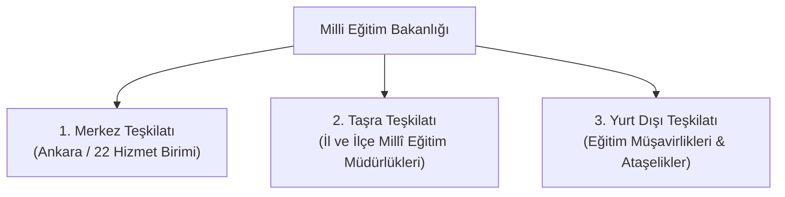
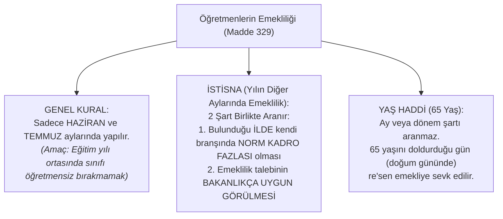

# 1 Sayılı Cumhurbaşkanlığı Kararnamesi — MEB Teşkilat Yapısı ve Hizmet Birimleri
> **EKYS 2027 Mevzuat Başucu Özeti, Turnusol Şifreler ve Soru Çözdüren İpuçları**  
> *Kaynak: Gökhan Hoca Canlı Ders Çözümlemesi (1 Sayılı CBK On Birinci Bölüm - Madde 301-331)*

---

## 📌 Genel Sınav Çerçevesi & Soru Dağılımı

- **Sınavdaki Ağırlığı:** EKYS Mevzuat alanında (toplam 16 soru) her yıl garanti **1 veya 2 soru** doğrudan bu kararnameden gelir.
- **Taktik / Metodoloji:** Sayfalarca süren görev metinlerini ezberlemek yerine, ÖSYM'nin soru kökünde kullandığı **Turnusol Şifre Kelimeler** üzerinden soruları saniyeler içinde çözmek.

---

## 🏛️ 1. MEB Teşkilat Yapısı (3 Temel Sacayağı)

Milli Eğitim Bakanlığı teşkilatı **3 ana yapıdan** meydana gelir:



> [!WARNING]
> **ÖSYM TUZAĞI:**
> - MEB teşkilat yapısında **"Bölge Teşkilatı"** veya **"Merkez-İlçe"** gibi ayrı bir kademe **YOKTUR!**
> - İlçe Millî Eğitim Müdürü, **İl Millî Eğitim Müdürüne** karşı sorumludur (Bu hiyerarşik bağ doğrudan bu kararnamede açıkça yazılıdır).
> - **Maarif Müfettişi = Eğitim Müfettişi** denkliği bu kararnamede hüküm altına alınmıştır.

---

## 📊 2. MEB Merkez Teşkilatı Sayısal Dağılımı (22 Hizmet Birimi)

MEB Merkez Teşkilatında toplam **22 Hizmet Birimi** bulunur:

| Birim Türü | Adet | Birim İsimleri |
| :--- | :---: | :--- |
| **Genel Müdürlük** | **16** | Temel Eğitim, Ortaöğretim, Mesleki ve Teknik, Din Öğretimi, Özel Eğitim ve Rehberlik, Özel Öğretim Kurumları, Hayat Boyu Öğrenme, YEĞİTEK, Bilgi İşlem, Ölçme Değerlendirme, Yükseköğretim ve Yurt Dışı, AB ve Dış İlişkiler, Personel, Hukuk Hizmetleri, Destek Hizmetleri, İnşaat ve Emlak |
| **Başkanlık** | **4** | • Talim ve Terbiye Kurulu Başkanlığı<br/>• Teftiş Kurulu Başkanlığı<br/>• Strateji Geliştirme Başkanlığı<br/>• Acil Durum ve Savunma Planlaması Dairesi Başkanlığı *(Daire başkanlığı statüsündeki tek birim)* |
| **Müşavirlik** | **1** | • Basın ve Halkla İlişkiler Müşavirliği |
| **Özel Kalem** | **1** | • Özel Kalem Müdürlüğü |
| **TOPLAM** | **22** | **Hizmet Birimi** |

> [!CAUTION]
> **HİZMET BİRİMİ OLMAYANLAR (Çeldiriciler):**
> 1. **İç Denetim Birimi Başkanlığı:** MEB hizmet birimleri listesinde yer **ALMAZ**.
> 2. **Millî Eğitim Akademisi Başkanlığı:** 7528 sayılı kanunla kurulan ayrı bir akademik başkanlıktır; 1 sayılı CBK hizmet birimi **DEĞİLDİR**.
> 3. **Bilgi İşlem Daire Başkanlığı:** Yanlıştır; Bilgi İşlem **GENEL MÜDÜRLÜĞÜ'DÜR**.

---

## 🔑 3. 22 Hizmet Birimi & Turnusol Anahtar Kelimeler Rehberi

### 📘 Kategori A: Örgün Eğitim Hizmet Birimleri

#### 1. Temel Eğitim Genel Müdürlüğü
- 🎯 **Turnusol Kelimeler:** `Okul öncesi`, `İlköğretim` (İlkokul + Ortaokul).
- 🚨 **Büyük Sınav Tuzağı:** Barınma söz konusu olduğunda Temel Eğitim **SADECE "ilköğretim öğrencilerinin barınması"** ile ilgilenir! Okul öncesinde yatılı veya pansiyonlu barınma hizmeti yoktur!

#### 2. Ortaöğretim Genel Müdürlüğü
- 🎯 **Turnusol Kelimeler:** `Ortaöğretim`, `Anadolu Liseleri`, `Fen Liseleri`, `Sosyal Bilimler`, `ortaöğretim barınma/pansiyon`.
- 🚨 **Tuzak:** Ders kitaplarını ve eğitim araçlarını hazırlayıp doğrudan bakana sunmaz; **Talim ve Terbiye Kurulu Başkanlığına sunar!**

#### 3. Mesleki ve Teknik Eğitim Genel Müdürlüğü
- 🎯 **Turnusol Kelimeler:** `3308 Sayılı Kanun`, `eğitim-istihdam ilişkisi`, `sektörel işbirlikleri`, `çırak`, `kalfa`, `usta`, `mesleki ve teknik anadolu lisesi`, `MESEM`.

#### 4. Din Öğretimi Genel Müdürlüğü
- 🎯 **Turnusol Kelimeler:** 
  - **TÜM KADEMELERDEKİ** (ilkokul, ortaokul, lise) `Din Kültürü ve Ahlak Bilgisi` dersleri ile din içerikli seçmeli derslerin programları.
  - `İmam Hatip Ortaokulları` ve `İmam Hatip Liseleri`.
  - `Hafızlık eğitimi` protokolleri ve projeleri.
  - Din ve ahlak eğitimi alanında üniversiteler ve ilgili kurumlarla işbirlikleri.
  - Ortak tarihi ve kültürel bağ bulunan ülkelerle **din eğitimi alanındaki** işbirlikleri.

---

### 📙 Kategori B: Özel & Yaygın Eğitim Hizmet Birimleri

#### 5. Özel Eğitim ve Rehberlik Hizmetleri Genel Müdürlüğü
- 🎯 **Turnusol Mantığı:** **ÖĞRENCİNİN KENDİSİ ÖZEL İSE!**
- 🔑 **Kelimeler:** `RAM (Rehberlik Araştırma Merkezi)`, `BİLSEM (Özel Yetenekliler)`, `İş Okulları`, `İş Eğitim Merkezleri`, `Kaynaştırma/Bütünleştirme`, `Özel eğitim sınıfları`, `Engelli bireyler`.

#### 6. Özel Öğretim Kurumları Genel Müdürlüğü
- 🎯 **Turnusol Mantığı:** **KURUMUN KENDİSİ ÖZEL/TİCARİ İSE!**
- 🔑 **Kelimeler:** `5580 Sayılı Kanun`, `Gerçek ve tüzel kişiler`, `Dernek ve vakıf okulları / kolejler`, `Özel yurtlar ve pansiyonlar`, `Motorlu taşıt sürücü kursları (MTSK)`, `Özel etüt ve sosyal etkinlik merkezleri`.

#### 7. Hayat Boyu Öğrenme Genel Müdürlüğü
- 🎯 **Turnusol Kelimeler:** `Zorunlu eğitim çağı dışı`, `Örgün eğitim dışına çıkmış vatandaşlar`, `Yaygın eğitim`, `Halk Eğitimi Merkezleri`, `Açık Öğretim Ortaokulu/Lisesi`, `Mesleki açık öğretim`.
- 🚨 **Tuzak:** Açık öğretim veya yaygın eğitim içerikleri **bilişim ve bilgi-iletişim teknolojilerine** dayanıyorsa bunu Hayat Boyu değil, **YEĞİTEK** hazırlar!

---

### 💻 Kategori C: Teknoloji, Sınav ve Dış İlişkiler Birimleri

```
┌─────────────────────────────────┬─────────────────────────────────┐
│     YEĞİTEK GENEL MÜDÜRLÜĞÜ     │   BİLGİ İŞLEM GENEL MÜDÜRLÜĞÜ   │
├─────────────────────────────────┼─────────────────────────────────┤
│ • EĞİTİM + TEKNOLOJİ / BİLİŞİM  │ • BAKANLIK + VERİ TABANI / AĞ   │
│ • EBA platformu, dijital içerik │ • MEBBİS, e-Okul otomasyonu     │
│ • Yapay Zekâ projeleri          │ • e-İmza, EBYS, e-Belge         │
│ • Eğitimde Ar-Ge, analiz, rapor │ • Sunucu, donanım, siber altyapı│
└─────────────────────────────────┴─────────────────────────────────┘
```

#### 8. Yenilik ve Eğitim Teknolojileri Genel Müdürlüğü (YEĞİTEK)
- 🎯 **Turnusol:** `Eğitimde teknoloji`, `dijital ders içeriği`, `EBA`, `yapay zekâ projeleri`, `eğitimde analiz ve izleme`, `girişimcilik ve yenilikçilik`.

#### 9. Bilgi İşlem Genel Müdürlüğü
- 🎯 **Turnusol:** `Bakanlığın veri tabanı`, `MEBBİS`, `e-Okul altyapısı`, `EBYS (Elektronik Belge Yönetim Sistemi)`, `e-İmza`, `sunucu ve ağ güvenliği`.

#### 10. Ölçme, Değerlendirme ve Sınav Hizmetleri Genel Müdürlüğü
- 🎯 **Turnusol Kelimeler:** `Sınav`, `Soru bankası`, `Ortak sınavlar`, `Sınav güvenliği`, `PISA / TIMSS (ulusal/uluslararası izleme-değerlendirme)`, `Ölçme araçları`.

#### 11. Yükseköğretim ve Yurt Dışı Eğitim Genel Müdürlüğü
- 🎯 **Turnusol Şifresi:** **"MEMLEKET"** kelimesi!
- 🔑 **Kelimeler:** `Yükseköğretime giriş esasları`, `Yurt dışındaki Türk vatandaşlarının eğitimi`, `1416 sayılı kanun`, `Ecnebi memleketlere gönderilen bursiyerler`.

#### 12. Avrupa Birliği ve Dış İlişkiler Genel Müdürlüğü
- 🎯 **Turnusol Şifresi:** **"YABANCI HÜKÜMET"** & **"PROTOKOL"**!
- 🔑 **Kelimeler:** `Avrupa Birliği eğitim programları`, `Uluslararası anlaşmalar`, `Yabancı hükümet bursları`, `Türk cumhuriyetleri ve akraba topluluklar (din eğitimi hariç)`, `Kurumlar arası protokoller`.

---

### 💼 Kategori D: Mali, İdari ve Destek Birimleri

#### 13. Personel Genel Müdürlüğü
- 🎯 **Turnusol Kelimeler:** `Öğretmen ve memur atamaları`, `yer değiştirme/nakil`, `özlük hakları`, `emeklilik işlemleri`, `kadro planlaması`.

#### 14. Hukuk Hizmetleri Genel Müdürlüğü
- 🎯 **Turnusol Kelimeler:** `Adli ve idari davalar`, `icra takipleri`, `hukuki uyuşmazlıklar`, `bakanlık adına dava açmak/savunmak`.

#### 15. Destek Hizmetleri Genel Müdürlüğü
- 🎯 **Turnusol Şifresi:** **5018 MALİ İŞLER + PARA KAZANAN KURUMLAR!**
- 🔑 **Kelimeler:** 
  - `5018 sayılı kanun gereği satın alma, ihale, kiralama, temizlik, güvenlik`.
  - `Taşınır ve taşınmaz kayıtları (TKYS), ambar, demirbaş`.
  - `Genel evrak ve arşiv hizmetleri`.
  - `Ders kitaplarının BASIMI ve DAĞITIMI` *(İçeriği yazmaz, sadece basıp okullara ulaştırır!)*.
  - `Taşımalı eğitim ve ücretsiz yemek işleri`.
  - `DÖNER SERMAYE İŞLETMELERİ`, `ÖĞRETMENEVLERİ`, `AKŞAM SANAT OKULLARI (ASO)`, `sosyal tesisler`.

#### 16. İnşaat ve Emlak Genel Müdürlüğü
- 🎯 **Turnusol Şifresi:** **BÜYÜK YAPIM, ARSA, BİNA, KAMULAŞTIRMA!**
- 🔑 **Kelimeler:** `Arsa temini`, `İmar planları`, `Kamulaştırma`, `Büyük onarım ve güçlendirme`, `Okul binalarının inşası`, `Ayni hak tesisi ve taşınmaz bağışları`.

---

### ⚖️ Kategori E: Denetim, Danışma ve Özel Birimler

#### 17. Talim ve Terbiye Kurulu Başkanlığı (En Kritik Birim)
- 🎯 **Büyük Turnusol Şifresi:** Cümlenin sonunda **"BAKANA SUNMAK"** yazar!
- 🔑 **Karakteri:** Bakanlığın **BİLİMSEL DANIŞMA VE İNCELEME ORGANIDIR**.
- 🌟 **3 Temel İlkesi:** **KALİTE**, **EŞİTLİK**, **ETKİLİLİK**.
- 📜 **Görevleri:** Türk millî eğitim sisteminin felsefesini oluşturmak, müfredat programlarını onaylamak, ders kitaplarını inceleyip karara bağlamak.
- 🏛️ **Düzenleme Şekli:** Kuruluş ve çalışma usulleri **CUMHURBAŞKANI YÖNETMELİĞİ** ile belirlenir.

#### 18. Teftiş Kurulu Başkanlığı
- 🎯 **Turnusol Kelimeler:** `Bakan adına denetim`, `Rehberlik`, `İnceleme ve soruşturma`, `Başmüfettiş / Müfettiş`.
- 🏛️ **Düzenleme Şekli:** Çalışma usul ve esasları **YÖNETMELİK** ile düzenlenir.

#### 19. Strateji Geliştirme Başkanlığı
- 🎯 **Turnusol Kelimeler:** `5 yıllık Stratejik Plan`, `Bakanlık bütçesinin hazırlanması ve birimlere tahsisi`, `Performans programı`, `Mali yönetim ve kontrol`.

#### 20. Basın ve Halkla İlişkiler Müşavirliği
- 🎯 **Turnusol Kelimeler:** `Basın bültenleri`, `4982 Sayılı Bilgi Edinme Hakkı Kanunu`, `CİMER ve MEBİM koordinasyonu`.

#### 21. Acil Durum ve Savunma Planlaması Dairesi Başkanlığı
- 🎯 **Turnusol Kelimeler:** `En son ihdas edilen birimdir`. `Afet ve kriz yönetimi`, `Deprem ve sel acil planları`, `Sivil savunma`, `Seferberlik ve savaş hali hazırlıkları`.

#### 22. Özel Kalem Müdürlüğü
- 🎯 **Turnusol Kelimeler:** `Bakanın günlük/haftalık çalışma programı`, `Resmi/özel yazışmaları`, `Protokol ve tören işleri`.

---

## 🔍 4. Genel Görevler (Md. 301) vs Hizmet Birimlerinin Ortak Görevleri (Md. 326)

| MEB Genel Görevleri (Madde 301 - Makro / Ülke Çapı) | Hizmet Birimlerinin Ortak Görevleri (Madde 326 - Mikro / Yatay) |
| :--- | :--- |
| • Okul öncesi, ilk ve orta öğrenim çağındaki öğrencileri bedeni, zihni, ahlaki, manevi yönden geliştirmek. | • Kendi hizmet alanına ilişkin hedef, politika ve kalite standartları belirlemek. |
| • Eğitimde fırsat ve imkân eşitliğini sağlamak. | • Eğitim-öğretimi etkileyen faktörleri araştırmak ve Ar-Ge çalışmaları yapmak. |
| • Kız çocukları, engelliler ve özel gereksinimli bireylerin eğitimini sağlamak. | • Kendi görev alanında özel eğitim ve rehberlik hizmetlerini koordine etmek. |
| • **Yükseköğretim HARİÇ** tüm eğitim kurumlarını açmak, kapatmak ve denetlemek. | • Kendi alanındaki sınav sonuçlarını değerlendirip raporlamak; birim bina/tesis planlamasını yapmak. |

> [!IMPORTANT]
> **MEB ÜNİVERSİTE AÇAMAZ:** MEB, yükseköğretim kurumları **dışındaki** tüm eğitim kurumlarını açar. Üniversiteler kanunla ve YÖK koordinasyonunda kurulur!

---

## 📜 5. Sınavda En Çok Çıkan 5 "Hukuki Düzenleme" Sorusunun Tablosu

| Düzenlenen Alan / İşlem | Düzenleyen Norm / Merci | Soru Şifresi |
| :--- | :---: | :--- |
| **Talim ve Terbiye Kurulu Bşk. oluşumu ve çalışma usulleri** | **CUMHURBAŞKANI YÖNETMELİĞİ** | *Kurulun ağırlığı CB düzeyindedir.* |
| **Öğretmen Norm Kadrolarının okullara dağıtılması** | **CUMHURBAŞKANI YÖNETMELİĞİ** | *Norm kadro yönetmeliği CB tarafından çıkarılır.* |
| **Bakanlık kadrolarının ihdası, iptali ve tahsisi** | **CUMHURBAŞKANLIĞI KARARNAMESİ** | *Kadro ihdasları genel CBK ile olur.* |
| **Öğretmenlerin aylık karşılığı okutacağı dersler** | **BAKANLIK YÖNETMELİĞİ** | *Doğrudan Millî Eğitim Bakanlığı belirler.* |
| **Teftiş Kurulu Başkanlığının çalışma usul ve esasları** | **YÖNETMELİK** | *Metinde merci yazmaz, yalnızca 'yönetmelik' geçer.* |

---

## ⏳ 6. Öğretmenlerin Emeklilik Kuralları (Madde 329)



---

## ⚡ 60 Saniyelik Sınav Flashcard Özeti

- 🔑 **"Bakana sunmak"** ➔ `Talim ve Terbiye Kurulu Bşk.`
- 🔑 **"Rehberlik, denetim, soruşturma"** ➔ `Teftiş Kurulu Bşk.`
- 🔑 **"3308 / Çırak / Kalfa / İstihdam"** ➔ `Mesleki ve Teknik Eğitim GM`
- 🔑 **"Dernek, vakıf, gerçek/tüzel / Özel yurt"** ➔ `Özel Öğretim Kurumları GM`
- 🔑 **"RAM / BİLSEM / İş okulu / Kaynaştırma"** ➔ `Özel Eğitim ve Rehberlik GM`
- 🔑 **"Eğitim + Teknoloji / Dijital içerik / EBA"** ➔ `YEĞİTEK GM`
- 🔑 **"Bakanlık + Bilişim / Veri tabanı / MEBBİS / EBYS"** ➔ `Bilgi İşlem GM`
- 🔑 **"Sınav / PISA / TIMSS / Ölçme araçları"** ➔ `Ölçme, Değerlendirme ve Sınav Hizmetleri GM`
- 🔑 **"Memleket / 1416 sayılı burs"** ➔ `Yükseköğretim ve Yurt Dışı Eğitim GM`
- 🔑 **"Yabancı Hükümet / Protokol / AB projeleri"** ➔ `Avrupa Birliği ve Dış İlişkiler GM`
- 🔑 **"Döner sermaye / Öğretmenevi / Kitap basım-dağıtım"** ➔ `Destek Hizmetleri GM`
- 🔑 **"Arsa, bina, kamulaştırma, okul inşası"** ➔ `İnşaat ve Emlak GM`
- 🔑 **"Afet, sivil savunma, kriz, seferberlik"** ➔ `Acil Durum ve Savunma Planlaması Dai. Bşk.`
- 🔑 **"Emeklilik Ayları"** ➔ `Haziran - Temmuz (İstisna: İl norm fazlası + Bakanlık onayı)`
