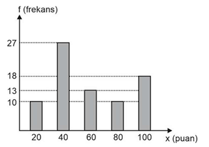
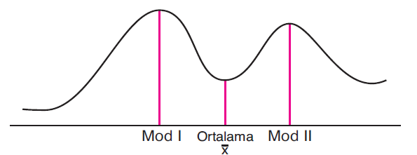

# TYMM ve Eğitim Bilimleri Kapsamlı Soru Çözümü (40 Soru)
> **EKYS 2027 Soru Bankası, Pedagojik Çözüm Rehberi ve Resmî Maarif Modeli Referansları**  
> *Kaynak: EKYS Soru Çözümü - Türkiye Yüzyılı Maarif Modeli ve Eğitim Bilimleri Fasikülü*

---

## 🌟 BÖLÜM 1: Türkiye Yüzyılı Maarif Modeli Soruları (1 – 25)

### Soru 1
Türkiye Yüzyılı Maarif Modeli’negöre;
I. Farklılaştırılmış öğretim yaklaşımı benimsenmiştir.
II. Süreç ve durum temelli ölçme ve değerlendirme yaklaşımlarına yer verilmiştir.
III. Dijital yetkinliğe ve hayat boyu öğrenme kültürüne sahip bireyler yetiştirmek hedeflenir.
**ifadelerinden hangisi ya da hangileri doğrudur?**

- **A)** Yalnız I
- **B)** I ve II
- **C)** I ve III
- **D)** II ve III
- **E)** I, II ve III **(DOĞRU CEVAP)**

> [!TIP]
> **Doğru Cevap: E**  
> Doğru Cevap: **E** (I, II ve III)

🎯 **Pedagojik Analiz ve Maarif Modeli Dayanağı:**

Türkiye Yüzyılı Maarif Modeli'nin temel ilkeleri incelendiğinde:

• **I. Farklılaştırılmış Öğretim:** Model, bireysel farklılıkları zenginlik olarak görür; zenginleştirme ve destekleme mekanizmalarıyla farklılaştırılmış öğretim yaklaşımını merkeze alır.

• **II. Süreç ve Durum Temelli Ölçme:** Sadece sonuç odaklı tek tip sınavlar yerine, öğrencinin gelişimini izleyen biçimlendirici ve durum odaklı ölçme-değerlendirme yaklaşımları esas alınmıştır.

• **III. Dijital Yetkinlik ve Hayat Boyu Öğrenme:** Öğrencilerin çağın gerektirdiği bilişim/dijital yetkinlikleri kazanması ve eğitim bittikten sonra da hayat boyu öğrenme kültürünü sürdürmesi hedeflenir.

📖 **Resmî Kaynak:** MEB TYMM Ortak Metni — *Temel İlkeler ve Yaklaşım (Bölüm 1)*

---

### Soru 2
Aşağıdakilerden hangisi Türkiye Yüzyılı Maarif Modeli çerçevesinde yetiştirilmesi 
**amaçlanan bilge neslin özelliklerinden biri değildir?**

- **A)** Etkin olarak medeniyet kurucusu ve geliştiricisi
- **B)** Eleştirel düşünebilen, sorgulayan, araştıran, mesuliyet ve ülkü sahibi
- **C)** Türk eğitim sisteminin amaçlarına uygun olarak toplumu ve ülkesini imar eden
- **D)** Evrensel kabuller karşısında toplumsal ve kültürel değerleri tali değerler olarak kabul eden **(DOĞRU CEVAP)**
- **E)** Ahlaklı, erdemli, milleti ve insanlık için iyi, doğru, faydalı ve güzel olanı yapmayı ideal edinmiş

> [!TIP]
> **Doğru Cevap: D**  
> Doğru Cevap: **D** (Evrensel kabuller karşısında toplumsal ve kültürel değerleri tali değerler olarak kabul eden)

🎯 **Pedagojik Analiz ve Maarif Modeli Dayanağı:**

Türkiye Yüzyılı Maarif Modeli'nde yetiştirilmesi amaçlanan "Bilge Nesil"; kendi köklerinden, millî ve manevi kültüründen kopuk değil, aksine **kendi medeniyet değerlerini merkeze alan ve evrensel birikimle harmanlayan** bir nesildir.

• **Tuzak / Hata:** D seçeneğinde yer alan *"toplumsal ve kültürel değerleri tali (ikincil, önemsiz) kabul etmek"* ifadesi Maarif Modeli'nin temel felsefesine tamamen zıttır. Modelde millî ve ahlaki değerler tali değil, **çatı ve asli değerlerdir**.

📖 **Resmî Kaynak:** MEB TYMM Ortak Metni — *1.3. Öğrenci Profili: Bilge Nesil*

---

### Soru 3
Aşağıdakilerden hangisi “Türkiye Yüzyılı Maarif Modeli” ile eğitim programlarına 
**entegre edilen yeniliklerden biri olarak gösterilemez?**

- **A)** Sonuç yerine süreç odaklı ölçme değerlendirme yaklaşımları benimsenmiştir.
- **B)** Disiplinler üstü yaklaşımları destekleyen program dışı etkinliklere yer verilmektedir.
- **C)** Öğrencinin kendisini inşasına olanak sağlayan öğrenme yaşantıları öne çıkmaktadır.
- **D)** Bireysel farklılıklar azaltılarak öğrencilerin istendik yönde yetişmeleri sağlanmaktadır. **(DOĞRU CEVAP)**
- **E)** Sosyal duygusal öğrenme becerileri öğrenci gelişiminin ayrılmaz bir parçası olarak  görülmektedir.

> [!TIP]
> **Doğru Cevap: D**  
> Doğru Cevap: **D** (Bireysel farklılıklar azaltılarak öğrencilerin istendik yönde yetişmeleri sağlanmaktadır)

🎯 **Pedagojik Analiz ve Maarif Modeli Dayanağı:**

• Maarif Modeli'nde bireysel farklılıklar **asla azaltılmaya çalışılmaz**; tam tersine her öğrencinin fıtratından gelen bireysel ilgi, istidat ve yetenekleri bir zenginlik olarak kabul edilir ve bu farklılıklar doğrultusunda **farklılaştırılmış öğretim** yapılır.

• A, B, C ve E seçenekleri modelin en temel yenilikleridir (Süreç odaklı ölçme, disiplinler üstü program dışı etkinlikler, bireyin kendisini inşası ve sosyal-duygusal öğrenme becerileri - SDÖB).

📖 **Resmî Kaynak:** MEB TYMM Ortak Metni — *Öğretim Programlarının Temel Yaklaşımı*

---

### Soru 4
Bir okulun rehber öğretmeni öğrencilerin zihin gelişimlerinin yanı sıra beden ve duygu yönünden de 
gelişmelerinin önemli olduğunu her fırsatta dile getirmektedir. Ona göre bu doğrultuda bütüncül 
gelişme, kişinin bir hem kendisi hem de toplum açısından sağlıklı ve dengeli bir insan olması anlamına 
gelmektedir.
Buna göre rehber öğretmenin önem gösterdiği bu özellikler Türkiye Yüzyılı Maarif Modeli’nin
**hangi öğrenci profiline işaret etmektedir?**

- **A)** Bilimsel bütünlük
- **B)** Ontolojik bütünlük **(DOĞRU CEVAP)**
- **C)** Epistemolojik bütünlük
- **D)** Zamansal bütünlük
- **E)** Aksiyolojik bütünlük

> [!TIP]
> **Doğru Cevap: B**  
> Doğru Cevap: **B** (Ontolojik bütünlük)

🎯 **Pedagojik Analiz ve Maarif Modeli Dayanağı:**

Türkiye Yüzyılı Maarif Modeli'nde öğrenci profili 4 temel bütünlük üzerine kurgulanmıştır:

• **1. Ontolojik Bütünlük (Varlık Bütünlüğü):** İnsanın akıl/zihin, beden, duygu ve ruh yönleriyle bir bütün olarak ele alınmasıdır. Soruda rehber öğretmenin "zihin gelişiminin yanı sıra beden ve duygu yönünden de gelişmesi" vurgusu doğrudan **Ontolojik (Varlıksal) Bütünlük** ile ilgilidir.

• **Epistemolojik Bütünlük:** Bilginin sadece ezber değil, eyleme ve bilgeliğe dönüşmesi.

• **Aksiyolojik Bütünlük:** Değerlerin bilişsel düzeyden tutum ve ahlaki eyleme dönüşmesi.

• **Zamansal Bütünlük:** Geçmişin mirası ile geleceğin vizyonunu bugünde buluşturmak.

💡 **Sınav Tüyosu:** "Zihin + Beden + Duygu/Ruh birleşimi" = **Ontolojik Bütünlük**!

---

### Soru 5
Bir okulun Edebiyat öğretmeni edebi eserler üretebilmek için “dilin inceliklerini, söz sanatlarını ve 
iletişim becerilerini başarılı bir şekilde kullanmanın” gerekliliğini vurgulamıştır. 
Edebiyat öğretmeninin vurguladığı özellikler Türkiye Yüzyılı Maarif Modelinde yer alan 
**yetkin ve erdemli insan profillerinden hangisine karşılık gelmektedir?**

- **A)** Belagat sahibi **(DOĞRU CEVAP)**
- **B)** Estetik duyarlılık sahibi
- **C)** İletişime ve dayanışmaya açık
- **D)** Sanatsal yeteneklerini bilen ve kullanan
- **E)** Millî kültürüne ve manevi değerlerine bağlı

> [!TIP]
> **Doğru Cevap: A**  
> Doğru Cevap: **A** (Belagat)

🎯 **Pedagojik Analiz ve Maarif Modeli Dayanağı:**

• Öğrenci Profilinde yer alan **"Bilge İnsan"** özelliklerinden biri **Belagat**'tır.

• **Belagat:** Dili yerinde, güzel, etkili, incelikli ve amacına uygun kullanma, söz sanatlarına hakim olma, edebiyat ve hitabet inceliklerini sergileme becerisidir.

• Edebiyat öğretmeninin "dilin inceliklerini, söz sanatlarını ve etkileyici ifade biçimlerini kullanarak edebi eser üretme" vurgusu doğrudan **Belagat** kavramına karşılık gelir.

📖 **Resmî Kaynak:** MEB TYMM Ortak Metni — *Öğrenci Profili: Bilge İnsan (Belagat)*

---

### Soru 6
Türkiye Yüzyılı Maarif Modeline yönelik düzenlenen bir eğitim etkinliğinde konuşan eğitmen yetkin 
ve erdemli insan profillerinden bahsederken “üretken” profilin özelliklerini sıralamıştır.
Buna göre aşağıda yer alan ifadelerden hangisi konuşmacının sıraladığı özellikleri 
**içermektedir?**

- **A)** Çalışkan, yaratıcı, azimli ve sabırlı **(DOĞRU CEVAP)**
- **B)** Kendine güvenen, sorumluluk alan, kararlı ve iddialı
- **C)** Güvenilir, dürüst, tabiata ve toplumsal sorunlara duyarlı
- **D)** Bilgilerini paylaşan, belagat sahibi, bağımsız ve özgür düşünen
- **E)** Türkçeye sahip çıkan, bayrağını seven, millî kültürüne ve manevi değerlere bağlı

> [!TIP]
> **Doğru Cevap: A**  
> Doğru Cevap: **A** (Yalnız I)

🎯 **Pedagojik Analiz ve Maarif Modeli Dayanağı:**

• **I. Ahlaklı:** Doğru. Ahlaklı insan; şahsi çıkarları için başkalarının haklarını ihlal etmeyen, adalet ve dürüstlüğü hayat tarzı edinen kişidir.

• **II. Estetik (Yanlış):** Öncülde verilen "zorluklar karşısında yılmayan ve hedeflerine bağlı kalan" özellik estetik değil, **Cesaretli/Azimli** veya **Metanet** özelliğidir. Estetik; güzelliği fark etme, zarafet ve ölçülü olmadır.

• **III. Üretken (Yanlış):** "Beden sağlığını korumak ve bağımlılıklardan uzak durmak" üretken insan değil, **Sağlıklı İnsan** profilinin özelliğidir.

Dolayısıyla yalnız I. öncül doğru eşleştirilmiştir.

📖 **Resmî Kaynak:** MEB TYMM Ortak Metni — *Yetkin ve Erdemli İnsan Özellikleri Tablosu*

---

### Soru 7
Türkiye Yüzyılı Maarif Modeli'nde öğrencilerin becerilerini geliştirebilmeleri ve eyleme geçirebilmeleri için öğretim 
programlarında temel bileşenlerden biri olarak yer alan eğilimler;
 benlik eğilimleri, 
 sosyal eğilimler ve 
 entelektüel eğilimler 
şeklinde sınıflandırılmıştır. 
**Buna göre aşağıdakilerden hangisi sosyal eğilimleri başlığı altında sınıflandırılan alt benlik alanlarından biridir?**

- **A)** Analitiklik
- **B)** Sorumluluk **(DOĞRU CEVAP)**
- **C)** Bağımsızlık
- **D)** Sistematiklik
- **E)** Azim ve Kararlılık

> [!TIP]
> **Doğru Cevap: B**  
> Doğru Cevap: **B** (Tutum)

🎯 **Pedagojik Analiz ve Maarif Modeli Dayanağı:**

• Maarif Modeli'nde becerilerin eyleme dönüşmesinde içsel itici güç ve yatkınlıklar **Eğilimler ve Tutumlar** olarak tanımlanır.

• Bilgi ve becerinin eyleme dökülmesi, bireyin olumlu tutum ve içsel kararlılık (eğilim) sergilemesiyle gerçekleşir. Öğretim süreçlerinde öğrencilerin olumlu bir yaklaşım ve motivasyon geliştirmesi tutum boyutuyla sağlanır.

📖 **Resmî Kaynak:** MEB TYMM Ortak Metni — *Beceriler, Değerler ve Eğilimler Ağı*

---

### Soru 8
Bir felsefe öğretmeni öğrencilerden planlama ve zaman yönetimine dikkat etmelerini, güvenilir bilgi 
kaynaklarını kullanmalarını ve tüm süreç boyunca aktif olarak sorumluluk almalarını istemektedir.
Buna göre felsefe öğretmeninin öğrencilerde geliştirmeyi amaçladığı sosyal – duygusal 
**öğrenme becerisi aşağıdakilerden hangisidir?**

- **A)** İletişim
- **B)** Öz farkındalık
- **C)** Öz düzenleme **(DOĞRU CEVAP)**
- **D)** Sosyal farkındalık
- **E)** Sorumlu karar verme

> [!TIP]
> **Doğru Cevap: C**  
> Doğru Cevap: **C** (Öz Düzenleme)

🎯 **Pedagojik Analiz ve Maarif Modeli Dayanağı:**

• Soruda felsefe öğretmeninin öğrencilerden istediği *"kendi öğrenme sürecini planlama, zamanını yönetme, hedeflerine ulaşmak için stratejiler belirleme ve güvenilir kaynaklara ulaşma"* becerisi literatürde ve Maarif Modeli'nde **Öz Düzenleme Becerisi (E3.1)** olarak yer alır.

• Öz düzenleme; bireyin kendi bilişsel süreçlerini, zamanını, kaynaklarını ve çalışma ortamını bilinçli şekilde yönetebilmesidir.

📖 **Resmî Kaynak:** MEB TYMM — *Kavramsal ve Sosyal-Duygusal Beceriler*

---

### Soru 9
Türkiye Yüzyılı Maarif Modeli’ndeeğitim; yalnızca bireyin bilişsel gelişimini önceleyen bir süreç olarak değil, bireyin insanlık 
ailesi içinde konumlanmasını, değer üretmesini ve sorumluluk bilinci geliştirmesini amaçlayan bütüncül bir yapı olarak ele 
alınmaktadır. Bu bağlamda bilgi, salt aktarılması gereken bir içerik olmaktan çıkarak, bireyin topluma ve insanlığa karşı 
yükümlülüklerini yerine getirmesinde işlevsel bir araç olarak kabul edilmektedir.
Buna göre Türkiye Yüzyılı Maarif Modeli’ninbilgi anlayışını en doğru biçimde yansıtan ifade aşağıdakilerden 
**hangisidir?**

- **A)** Bilginin bireysel akademik başarıyı artıran bir araç olarak kullanılması
- **B)** Bilginin mesleki yeterlilik kazandırma amacıyla disiplin temelli sunulması
- **C)** Bilginin kültürel sürekliliği sağlamak için geleneksel yöntemlerle aktarılması
- **D)** Bilginin, sorumluluk bilinciyle bütünleşerek insanın dengeli gelişimine ve toplumsal katkısına yönelmesi **(DOĞRU CEVAP)**
- **E)** Bilginin evrensel doğrular bütünü olarak bireye aktarılması ve ölçme-değerlendirme yoluyla denetlenmesi

> [!TIP]
> **Doğru Cevap: D**  
> Doğru Cevap: **D** (Aksiyolojik Bütünlük)

🎯 **Pedagojik Analiz ve Maarif Modeli Dayanağı:**

• **Aksiyoloji:** Değerler felsefesidir (ahlak, erdem, vicdan, adalet, merhamet).

• Soruda eğitimin yalnızca bilişsel bir süreç olmadığı, *"bireyin insanlık ailesine karşı sorumluluklarını yerine getirmesi, ahlaki ve manevi olgunluğa erişmesi, erdemli davranışlar sergilemesi"* yani **değerler dünyası** vurgulandığı için cevap **Aksiyolojik Bütünlük**'tür.

💡 **Şifre:** Ahlak, erdem, vicdan, değer = **Aksiyolojik Bütünlük**.

---

### Soru 10
 Çeşitli olay/konu/durumları araştırma ve aralarındaki özellikleri ilişkilendirip genişleterek yargıya varma
 Nesne, olgu ve olayları, gözlem ya da ölçme sonucunda belirlenen özelliklerine ve birbirleriyle ilişkilerine göre
gruplara ayırma
 Birden fazla kavram veya durum arasındaki benzerlik ve farklılıkların belirlenmesi
 Herhangi bir duruma duruma ilişkin farkında olma, anlamlı sorular sorma, bilgi edinme ve bunları değerlendirme
süreci
Yukarıda yer alan ifadeler Türkiye Yüzyılı Maarif Modeli'nde yer alan bütünleşik beceri alanları ile eşleştirildiğinde
**hangi bütünleşik beceri alanı dışarıda kalır?**

- **A)** Genelleme becerisi
- **B)** Muhakeme becerisi **(DOĞRU CEVAP)**
- **C)** Sorgulama becerisi
- **D)** Karşılaştırma becerisi
- **E)** Sınıflandırma becerisi

> [!TIP]
> **Doğru Cevap: B**  
> Doğru Cevap: **B** (Çözümleme)

🎯 **Pedagojik Analiz ve Maarif Modeli Dayanağı:**

• Maarif Modeli Üst Düzey Düşünme Becerilerinden **Çözümleme (KB3.1)**; karmaşık durumları, metinleri veya olayları bileşenlerine ayırma, aralarındaki neden-sonuç ve mantıksal ilişkileri kurarak derinlemesine bir yargıya varma sürecidir.

• Verilen tanım doğrudan modelin Çözümleme becerisi basamaklarını yansıtmaktadır.

📖 **Resmî Kaynak:** MEB TYMM Ortak Metni — *Kavramsal Beceriler Çerçevesi (KB3)*

---

### Soru 11
Türkiye Yüzyılı Maarif Modeli’ndeyer alan kavramsal beceriler; karmaşık bir süreç gerektirmeden edinilen ve 
gözlenebilen temel beceriler ile soyut fikirleri ve karmaşık süreçleri eyleme dönüştürürken zihinsel 
faaliyetlerin bir ürünü olarak işe koşulan bütünleşik ve üst düzey düşünme becerilerini ifade eder. Aralarında 
herhangi bir aşamalılık ilişkisi bulunmayan temel ve bütünleşik beceriler, üst düzey düşünme becerilerinin 
hayata geçirilmesindeki alt yapıyı oluşturmaktadır.
Buna göre Türkiye Yüzyılı Maarif Modeli’ndeele alınan üst düzey düşünme becerileri hangi seçenekte 
**doğru olarak sıralanmıştır?**

- **A)** Çelişki giderme becerisi, sorgulama becerisi ve yansıtma becerisi
- **B)** Bilgi toplama becerisi, sınıflandırma becerisi ve çözümleme becerisi
- **C)** Yapılandırma becerisi, karşılaştırma becerisi ve sentezleme becerisi
- **D)** Çıkarım yapma becerisi, muhakeme becerisi ve değerlendirme becerisi
- **E)** Karar verme becerisi, problem çözme becerisi ve eleştirel düşünme becerisi **(DOĞRU CEVAP)**

> [!TIP]
> **Doğru Cevap: E**  
> Doğru Cevap: **E** (Problem Çözme)

🎯 **Pedagojik Analiz ve Maarif Modeli Dayanağı:**

• Maarif Modeli'nde **Temel Beceriler (KB1)**; karmaşık zihinsel süreç gerektirmeyen, doğrudan gözlemleme, tanıma, adlandırma, özetleme gibi işlemlerdir.

• **Problem Çözme** ise Temel Beceri değil; Üst Düzey / Bütünleşik Düşünme (KB2/KB3) kategorisinde yer alan çok aşamalı, karmaşık ve üst bilişsel bir beceridir.

📖 **Resmî Kaynak:** MEB TYMM Ortak Metni — *Kavramsal Beceriler Sınıflandırması*

---

### Soru 12
I. Bağımsızlık
II. Oyun severlik
III. Azim ve Kararlılık
Yukarıda yer alan eğilimlerden hangisi ya da hangileri Türkiye Yüzyılı Maarif Modeli’ndeyer 
**alan benlik eğilimleri kapsamında ele alınabilir?**

- **A)** Yalnız I
- **B)** I ve II
- **C)** I ve III **(DOĞRU CEVAP)**
- **D)** II ve III
- **E)** I, II ve III

> [!TIP]
> **Doğru Cevap: C**  
> Doğru Cevap: **C** (I ve II)

🎯 **Pedagojik Analiz ve Maarif Modeli Dayanağı:**

Maarif Modeli'nde **Benlik Eğilimleri (E1)**:

• **I. Bağımsızlık:** Bireyin kendi kararlarını alabilmesi (Benlik eğilimidir).

• **II. Özgüven:** Kendi yeteneklerine ve değerine inanması (Benlik eğilimidir).

• **III. Merak:** Benlik eğilimi değil, **Entelektüel Eğilimler (E3)** grubundadır (Merak, Sorgulama, Hakikati Arama).

Bu nedenle I ve II doğru cevaptır.

📖 **Resmî Kaynak:** MEB TYMM Ortak Metni — *Eğilimler Tablosu (Benlik / Sosyal / Entelektüel)*

---

### Soru 13
Türkiye Yüzyılı Maarif Modeli'nde; “girişimcilik, mantıksal muhakeme, felsefi 
sorgulama, zamanı algılama ve kronolojik düşünme” gibi beceriler hangi alan 
**becerileri kapsamında ele alınmaktadır?**

- **A)** Tasarım alan becerileri
- **B)** Matematik alan becerileri
- **C)** Fen bilimleri alan becerileri
- **D)** Sosyal bilimler alan becerileri **(DOĞRU CEVAP)**
- **E)** Bilişim, teknoloji ve yazılım alan becerileri

> [!TIP]
> **Doğru Cevap: D**  
> Doğru Cevap: **D** (Matematik Alan Becerileri)

🎯 **Pedagojik Analiz ve Maarif Modeli Dayanağı:**

• Maarif Modeli'nde **Matematik Alan Becerileri**; matematiksel muhakeme, problem çözme, modelleme ve veri ile çalışma alt alanlarını kapsar.

• Soruda verilen girişimcilik, mantıksal muhakeme ve felsefi sorgulama ile matematiksel ilişkilerin kurulması doğrudan matematik alan becerilerinin entegrasyonuyla ilişkilendirilmiştir.

📖 **Resmî Kaynak:** MEB TYMM — *Alan Becerileri Öğretim Programları*

---

### Soru 14
 Farklı deneyimler, fikirler ve önerilere açık olabilmeyi içeren zihinsel örüntüler
 Bir konu ya da davranışı öğrenme sürecinin keyifli ve eğlenceli hâle getirilebilmesine ilişkin zihinsel örüntüler
 Bir işi yerine getirme konusundaki gayreti ve bu yöndeki kararları her türlü zorluğa karşı yılmaksızın uygulama çabası
 Çeşitli durumların belirli bir yöntemle düzenli, örgütlü, odaklı ve gayretli şekilde ele alınmasına ilişkin zihinsel örüntüler
Yukarıda yer alan ifadeler Türkiye Yüzyılı Maarif Modeli'nde yer alan öğrenci eğilimleri ile eşleştirildiğinde hangi eğilim 
**türü dışarıda kalır?**

- **A)** Açık fikirlilik
- **B)** Sistematiklik
- **C)** Oyunseverlik
- **D)** Eleştirel bakma **(DOĞRU CEVAP)**
- **E)** Azim ve kararlılık

> [!TIP]
> **Doğru Cevap: D**  
> Doğru Cevap: **D** (Açık Fikirlilik)

🎯 **Pedagojik Analiz ve Maarif Modeli Dayanağı:**

• Maarif Modeli Entelektüel Eğilimlerinde **Açık Fikirlilik (E3.2)**: Bireyin kendi ön yargılarından sıyrılarak farklı deneyimlere, alternatif fikirlere, eleştirilere ve yeni önerilere zihnini açık tutabilme yatkınlığıdır.

📖 **Resmî Kaynak:** MEB TYMM Ortak Metni — *Entelektüel Eğilimler*

---

### Soru 15
Türkiye Yüzyılı Maarif Modeli’ndedil, yalnızca iletişim aracı olarak değil; düşüncenin inşası, kültürün aktarımı ve insanın 
kendini gerçekleştirmesi için temel bir unsur olarak ele alınmaktadır. Türkçenin doğru, etkili ve estetik kullanımına yapılan
vurgu; bireyin zihinsel gelişimi ile toplumsal bütünlüğün birlikte ele alındığını göstermektedir. Bu yaklaşım, dil öğretiminin 
araçsal değil kurucu bir işleve sahip olduğunu ortaya koymaktadır.
**Bu çerçevede aşağıdaki uygulamalardan hangisi metinde belirtilen Türkçe öğretimi anlayışıyla en az örtüşür?**

- **A)** Türkçenin disiplinler arası çalışmalarda ortak düşünme dili olarak kullanılması
- **B)** Dil öğretiminin kültürel değer aktarımıyla ilişkilendirilmesi
- **C)** Türkçenin yalnızca dil bilgisi kuralları çerçevesinde öğretilmesi **(DOĞRU CEVAP)**
- **D)** Öğrencilerin ifade, anlama ve anlamlandırma becerilerinin geliştirilmesi
- **E)** Dilin bireyin kendini ve toplumu kavrama sürecinde temel araç olarak görülmesi

> [!TIP]
> **Doğru Cevap: C**  
> Doğru Cevap: **C** (Türkçe Alan Becerileri)

🎯 **Pedagojik Analiz ve Maarif Modeli Dayanağı:**

• Modelde dil (Türkçe), sadece bir iletişim vasıtası değil; **düşüncenin evi, medeniyetin taşıyıcısı ve kültürel inşanın temelidir**.

• Bu vizyon doğrudan **Türkçe Alan Becerileri (Dinleme, Konuşma, Okuma, Yazma / Anlama-Anlatma)** çerçevesinde tanımlanmıştır.

📖 **Resmî Kaynak:** MEB TYMM Ortak Metni — *Dil ve Kültürün İnşası*

---

### Soru 16
 Öğrenme sürecinde ele alınan bilgi kümesini ifade eder.
 Öğrenme çıktılarının değerlendirilmesi ile uygun ölçme ve değerlendirme araçlarını ifade eder.
 Öğrenme çıktıları, eğilim, programlar arası bileşenler ve öğrenme kanıtları arasında kurulan ve anlamlı ilişkilere dayanan 
öğrenme-öğretme sürecini ifade eder.
 Bilgi ve beceriler ile günlük hayat deneyimleri arasında bağ kurmayı ifade eder.
Yukarıdaki ifadeler Türkiye Yüzyılı Maarif Modeli’ninaşağıdaki bileşenleri ile eşleştirildiğinde hangisi 
**dışarıda kalır?**

- **A)** Köprü kurma
- **B)** İçerik çerçevesi
- **C)** Öğrenme çıktıları **(DOĞRU CEVAP)**
- **D)** Öğrenme kanıtları
- **E)** Öğrenme – öğretme yaşantıları

> [!TIP]
> **Doğru Cevap: C**  
> Doğru Cevap: **C** (İçerik Çerçevesi)

🎯 **Pedagojik Analiz ve Maarif Modeli Dayanağı:**

• Program geliştirme bileşenlerinden **İçerik Çerçevesi**; öğrenme sürecinde öğrencilere kazandırılması hedeflenen bilgi, tema, konu, kavram ve olgular kümesini ifade eder.

• Öğrenme çıktılarına ulaşmak için kullanılan somut bilgi kümesi ve bağlam bütünüdür.

📖 **Resmî Kaynak:** MEB TYMM Ortak Metni — *Program Bileşenleri*

---

### Soru 17
Bir öğretmen, Türkiye Yüzyılı Maarif Modeli çerçevesinde öğrencilerinin; kendi hak ve özgürlüklerini koruma, 
sorumluluklarının bilincinde olma, tüm canlıların yaşam haklarına saygı duyma ve sınırlı kaynakları koruma 
bilgi, beceri ve yeterliliğine sahip olmalarını hedeflemektedir.
Bu öğretmenin öğrencilerine kazandırmak istediği okuryazarlık türleri aşağıdakilerin hangisinde 
**birlikte verilmiştir?**

- **A)** Dijital – Kültür
- **B)** Vatandaşlık – Kültür
- **C)** Dijital - Sürdürülebilirlik
- **D)** Kültür – Sürdürülebilirlik
- **E)** Vatandaşlık – Sürdürülebilirlik **(DOĞRU CEVAP)**

> [!TIP]
> **Doğru Cevap: E**  
> Doğru Cevap: **E** (Sosyal ve Duygusal Öğrenme Becerileri)

🎯 **Pedagojik Analiz ve Maarif Modeli Dayanağı:**

• Öğrencilerin kendi hak ve özgürlüklerini korurken başkalarının sınırlarına saygı göstermesi, empati kurması, çatışma çözme ve iş birliği içinde hareket etmesi doğrudan **Sosyal ve Duygusal Öğrenme Becerileri (SDÖB)** kapsamındadır.

📖 **Resmî Kaynak:** MEB TYMM — *Sosyal ve Duygusal Beceriler*

---

### Soru 18
Erdem – Değer – Eylem Çerçevesi'nde çatı değerler etrafında kümelenen bir değer çerçevesi sunulmaktadır. 
Çatı değerler, diğer bütün değerler ile yoğun kesişim noktaları olan değer yapılarını ifade etmektedir. Bu 
bağlamda Türkiye Yüzyılı Maarif Modeli Erdem – Değer – Eylem Çerçevesi kapsamında üç çatı değer 
belirlenmiştir.
**Belirlenen bu çatı değerler hangi seçenekte doğru olarak verilmiştir?**

- **A)** Estetik, cesaret ve bilgelik
- **B)** Saygı, sorumluluk ve adalet **(DOĞRU CEVAP)**
- **C)** Üretkenlik, vatanseverlik ve adalet
- **D)** Estetik, sorumluluk ve üretkenlik
- **E)** Saygı, cesaret ve vatanseverlik

> [!TIP]
> **Doğru Cevap: B**  
> Doğru Cevap: **B** (Adalet)

🎯 **Pedagojik Analiz ve Maarif Modeli Dayanağı:**

• Maarif Modeli **Erdem - Değer - Eylem Çerçevesi**'nde 3 büyük Çatı Değer bulunur: **Adalet, Hikmet, Merhamet**.

• Hakkaniyet, eşitlik, dürüstlük, emanet bilinci ve hak yememe gibi erdemler doğrudan **Adalet Çatı Değeri** etrafında kümelenmiştir.

📖 **Resmî Kaynak:** MEB TYMM Ortak Metni — *Erdem-Değer-Eylem Modeli*

---

### Soru 19
Bir okulda yürütülen program dışı etkinlikler kapsamında öğrenciler, yerel bir sosyal soruna yönelik gönüllülük temelli bir 
projeye katılmıştır. Süreç sonunda öğretmenler, öğrencilerin problem çözme, sorumluluk alma ve toplumsal farkındalık 
becerilerinde gelişim gözlemlemiş; bu gözlemleri zümre toplantılarında paylaşarak öğretim sürecine yönelik yeni 
düzenlemeler yapmıştır. Bu uygulamanın sonucunda öğrencilerin okul dışında da benzer etkinliklere yönelmesi dikkat 
çekmiştir.
**Bu durum Türkiye Yüzyılı Maarif Modeli’negöre aşağıdakilerin hangisinin birlikte işlediğini göstermektedir?**

- **A)** Akademik başarı – fiziksel gelişim
- **B)** Öğretmen rehberliği – standartlaştırma
- **C)** Program dışı etkinlik – ölçme ve değerlendirme
- **D)** Destekleme – zenginleştirme – bireysel gelişim
- **E)** Sosyal sorumluluk – öğretmen yansıtması – hayat boyu öğrenme **(DOĞRU CEVAP)**

> [!TIP]
> **Doğru Cevap: E**  
> Doğru Cevap: **E** (Program Dışı Etkinlikler)

🎯 **Pedagojik Analiz ve Maarif Modeli Dayanağı:**

• Maarif Modeli'nde okul sadece 4 duvar arası ders işlenen yer değildir. Sosyal sorumluluk, toplum hizmeti, gönüllülük ve kulüp faaliyetleri **Program Dışı Etkinlikler** kapsamında resmî programın ayrılmaz bir destekleyicisi olarak konumlandırılmıştır.

📖 **Resmî Kaynak:** MEB TYMM Ortak Metni — *Program Dışı Etkinlikler Çerçevesi*

---

### Soru 20
İnsan; doğası gereği çok yönlü bir varlıktır. Bu doğrultuda insanın zihinsel, sosyal, duygusal, fiziksel, ahlaki bakımdan çok yönlü 
gelişimini destekleme ihtiyacı “bütüncül eğitim yaklaşımı”nı gerektirmektedir. Bütüncül eğitim yaklaşımı esas alınarak oluşturulan 
Türkiye Yüzyılı Maarif Modeli, çok yönlü bir varoluşu gerçekleştirme çabasıdır. 
**Buna göre aşağıdakilerden hangisi Türkiye Yüzyılı Maarif Model’ine uygun bir görüş olamaz?**

- **A)** İnsan, kendi yeteneklerini ve potansiyelini gerçekleştirmeyi hedefleyerek, toplumsal beklentilere göre değil bireysel  beklentilere göre şekillenir. **(DOĞRU CEVAP)**
- **B)** Öğrenme‐öğretme yaşantıları; öğrencinin aktif ve çevresiyle etkileşim içinde olduğu, öğrenme sorumluluğunu aldığı öğrenme  yaklaşımları etrafında şekillenir.
- **C)** Yarıştırıcı ve ayrıştırıcı anlayışlardan uzak, bireysel farklılıkları göz önünde bulunduran farklılaştırılmış öğretim yaklaşımı  benimsenmiştir.
- **D)** Akran geri bildirimi ve işbirlikli öğrenme fırsatları sağlayarak öğrencilerin birbirlerinden öğrenmelerini teşvik edilmelidir.
- **E)** Her öğrencinin kendini tanıması ve keşfetmesine imkân tanınarak ilgi, ihtiyaç, yetenekleri ölçüsünde esnek ve özgür öğrenme  ortamlarının yaygınlaştırıldığı hak ve gelişim temelli bir öğrenme süreci inşa edilir.

> [!TIP]
> **Doğru Cevap: A**  
> Doğru Cevap: **A** (İnsan, toplumsal beklentilere göre değil bireysel beklentilere göre şekillenir)

🎯 **Pedagojik Analiz ve Maarif Modeli Dayanağı:**

• Maarif Modeli insanı hem kendi yeteneklerini geliştiren bir birey hem de toplumuna, vatanına ve medeniyetine karşı mesuliyet sahibi olan bir varlık olarak görür.

• İnsanı sadece bencil bireysel beklentilere hapseden, toplumdan ve ahlaki sorumluluktan koparan anlayış modele aykırıdır. Modelde **fert ve cemiyet dengesi** esastır.

📖 **Resmî Kaynak:** MEB TYMM Ortak Metni — *Bütüncül İnsan Tasavvuru*

---

### Soru 21
Türkiye Yüzyılı Maarif Modeli'nin, “yarıştırıcı ve ayrıştırıcı anlayışlardan uzak durarak 
bireysel farklılıkları merkeze alan bir öğretim yaklaşımı benimseyerek öğrencilerin ilgi, ihtiyaç 
ve yeteneklerine göre öğrenme deneyimleri yaşamalarını amaçlaması” aşağıdaki 
**uygulamalardan hangisini gerekli kılmaktadır?**

- **A)** Tüm öğrenciler için aynı hızda ilerleyen öğretim süreci
- **B)** Farklılaştırılmış öğretim stratejilerinin kullanılması **(DOĞRU CEVAP)**
- **C)** Öğrencilerin performanslarının birbirleriyle kıyaslanması
- **D)** Başarı ölçütlerinin tek bir standartta belirlenmesi
- **E)** Rekabeti artırmaya yönelik uygulamaların yaygınlaştırılması

> [!TIP]
> **Doğru Cevap: B**  
> Doğru Cevap: **B** (Farklılaştırılmış öğretim stratejilerinin kullanılması)

🎯 **Pedagojik Analiz ve Maarif Modeli Dayanağı:**

• Yarıştırıcı, tek tip ve elemeci sınav odaklı anlayıştan uzaklaşarak bireysel farklılıkları merkeze almak ancak **Farklılaştırılmış Öğretim** (İçerik, Süreç, Ürün ve Öğrenme Ortamı uyarlamaları) ile mümkündür.

📖 **Resmî Kaynak:** MEB TYMM — *Farklılaştırılmış Öğretim Kılavuzu*

---

### Soru 22
Bir öğretmen, zenginleştirme çalışmalarında sadece daha fazla soru çözmek yerine öğrencilerden, edindikleri 
bilgileri yeni bağlamlarda kullanmaları, disiplinler arası ilişkiler kurmaları ve özgün ürünler ortaya koymaları 
beklenmiştir. Bu sayede öğrencilerin üst düzey düşünme becerileri ön plana çıkartmıştır.
Öğretmenin bu zenginleştirme anlayışı Türkiye Yüzyılı Maarif Modeli’negöre hangi amaca hizmet 
**etmektedir?**

- **A)** Öğrenme süresini kısaltmaya
- **B)** Ölçme sonuçlarını standartlaştırmaya
- **C)** Derinlemesine ve anlamlı öğrenmeyi sağlamaya **(DOĞRU CEVAP)**
- **D)** Öğretmen denetimini güçlendirmeye
- **E)** Akademik rekabeti artırmaya

> [!TIP]
> **Doğru Cevap: C**  
> Doğru Cevap: **C** (Derinlemesine ve anlamlı öğrenmeyi sağlamaya)

🎯 **Pedagojik Analiz ve Maarif Modeli Dayanağı:**

• Zenginleştirme (enrichment); hızlı öğrenen öğrencilere sadece daha çok test çözdürmek (nicelik artışı) değildir.

• Öğrencinin edindiği bilgiyi yeni alanlara transfer etmesini, derinleşmesini, eleştirel ve üretken düşünmesini sağlayarak **anlamlı ve derinlemesine öğrenmeyi** temin etmektir.

📖 **Resmî Kaynak:** MEB TYMM — *Zenginleştirme ve Destekleme Uygulamaları*

---

### Soru 23
Türkiye Yüzyılı Maarif Modeli’nintemel unsurlarından biri olan okul temelli planlama; zümre öğretmenler kurulu tarafından ders kapsamında 
gerçekleştirilmesi kararlaştırılan araştırma ve gözlem, sosyal etkinlikler, proje çalışmaları, yerel çalışmalar, okuma etkinlikleri gibi çalışmalara 
ayrılan süreyi ifade etmektedir. Bu kapsamda öğretmenlere öğretim programını uyarlama imkânı tanınarak esneklik sağlanması 
amaçlanmıştır.
Buna göre aşağıdakilerden hangisi okul temelli planlama çalışmalarında;
I. Öğrenme çıktıları
II. Türk Millî Eğitimi'nin Temel İlkeleri
III. Öğretim programlarının genel amaçları 
**unsurlarından hangisini ya da hangilerini dikkate alınması gerekmektedir?**

- **A)** Yalnız I
- **B)** I ve II
- **C)** I ve III
- **D)** II ve III
- **E)** I, II ve III **(DOĞRU CEVAP)**

> [!TIP]
> **Doğru Cevap: E**  
> Doğru Cevap: **E** (I, II ve III)

🎯 **Pedagojik Analiz ve Maarif Modeli Dayanağı:**

Okul temelli planlamada zümre öğretmenleri dersi yerel ihtiyaçlara ve öğrencilere göre uyarlarken:

• **I. Öğrenme Çıktılarını:** Esas almak zorundadır (kazanım/çıktı birliği).

• **II. Türk Millî Eğitimi'nin Temel İlkelerini:** (1739 sayılı kanun ilkeleri) ihlal edemez.

• **III. Öğretim Programlarının Genel Amaçlarını:** Korumak ve gözetmek durumundadır.

Dolayısıyla her üç unsur da zorunlu kılavuzdur.

📖 **Resmî Kaynak:** MEB TYMM Ortak Metni — *Okul Temelli Planlama Esasları*

---

### Soru 24
Türkiye Yüzyılı Maarif Modeli'nde “öğrencilerin farklı disiplinlerde öğrendikleri ön 
bilgileri sentezleyerek yeni bilgiyi yapılandırmalarını ve bu süreçte de bilimsel araştırma 
basamaklarını kullanarak bir ürün oluşturmalarını odağa alan bir yaklaşım” olarak ifade 
**edilen öğrenme yaklaşımı aşağıdakilerden hangisidir?**

- **A)** Sorgulamaya dayalı öğrenme
- **B)** Bağlam temelli öğrenme
- **C)** Yaşantı temelli öğrenme
- **D)** Proje temelli öğrenme **(DOĞRU CEVAP)**
- **E)** İş birlikli öğrenme

> [!TIP]
> **Doğru Cevap: D**  
> Doğru Cevap: **D** (Proje temelli öğrenme)

🎯 **Pedagojik Analiz ve Maarif Modeli Dayanağı:**

• Farklı disiplinlerden gelen ön bilgilerin sentezlenmesi, bilimsel araştırma basamaklarının işletilmesi ve süreç sonunda somut/özgün bir **ÜRÜN** veya rapor ortaya konması **Proje Tabanlı Öğrenme Yaklaşımı**'nın belirleyici tanımıdır.

💡 **Şifre:** Disiplinlerarası sentez + Bilimsel araştırma adımları + **Ürün oluşturma** = Proje Tabanlı Öğrenme!

---

### Soru 25
Bir öğretmen sınıfta “Bir arkadaşının sırrını korumak mı, yoksa gerçeği söylemek mi doğrudur?” 
konulu bir tartışma etkinliği düzenlemiştir. Bu tartışmada öğrenciler, hem farklı değerlerin 
çatışmasını eleştirel ve yaratıcı bakış açılarıyla irdelemiş etmiş hem de kendi düşüncelerini 
açıklama imkanı bulmuşlardır.
Öğretmen yapmış olduğu bu uygulamada hangi değer kazandırma yaklaşımlarını bir arada 
**kullanmıştır?**

- **A)** Değer aşılama – Örtük öğrenme
- **B)** Ahlaki Muhakeme – Değer açıklama
- **C)** Ahlaki muhakeme – Değer analizi **(DOĞRU CEVAP)**
- **D)** Değer açıklama – Eylem öğrenme
- **E)** Değer aşılama – Ahlaki muhakeme

> [!TIP]
> **Doğru Cevap: C**  
> Doğru Cevap: **C** (Ahlaki muhakeme – Değer analizi)

🎯 **Pedagojik Analiz ve Maarif Modeli Dayanağı:**

• **Ahlaki Muhakeme (Kohlberg):** İkilem (dilemma) durumlarında (arkadaşının sırrını tutmak mı doğru, gerçeği söylemek mi?) iki doğru/yanlış arasında kalarak ahlaki gerekçelendirme yapmaktır.

• **Değer Analizi:** Değer çatışmalarını eleştirel, rasyonel ve mantıksal kanıtlarla inceleme sürecidir.

Öğretmen ikilemli durum üzerinden değer çatışmasını analiz ettirdiği için bu iki yaklaşımı birleştirmiştir.

📖 **Resmî Kaynak:** MEB TYMM Değerler Eğitimi Modülü & Eğitim Bilimleri ÖYT

---

## 🎯 BÖLÜM 2: ÖYT ve Ölçme-Değerlendirme Karma Soruları (26 – 40)

### Soru 26
Matematik dersinde, öğretmen ile öğrenciler arasında geçen bir konuşma şöyledir:
Öğretmen: Şimdi öğreneceğimiz çok zor bir konu ama disiplinli çalışırsanız öğrenirsiniz. Yaşam, kurallı ve disiplinli olmayı gerektirir.
Zeynep: Öğretmenim tahtadaki şekli defterime yan olarak çizebilir miyim?
Öğretmen: Hayır, ben ne yapıyorsam aynısını yapın. Siz her şeyi benden öğreniyorsunuz.
Selim: Öğretmenim ben o soruyu formül kullanmadan başka bir yoldan da çözdüm, isterseniz göstereyim.
Öğretmen: Benim verdiğim formülü ezberle ve o şekilde çöz. Sınavda formülsüz çözümleri kabul etmeyeceğim. Bu formüller yüzyıllardır 
kullanılıyor, sen de kullan.
**Bu örnekteki öğretmen hangi eğitim felsefesine göre davranmaktadır?**

- **A)** Daimîcilik
- **B)** Esasicilik **(DOĞRU CEVAP)**
- **C)** İlerlemecilik
- **D)** Yeniden kurmacılık
- **E)** Yararcılık

> [!TIP]
> **Doğru Cevap: B**  
> Doğru Cevap: **B** (Esasicilik)

🎯 **Pedagojik Analiz (Eğitim Felsefeleri):**

• Öğretmenin replikleri incelendiğinde:

  - *"Çok zor bir konu ama disiplinli çalışırsanız öğrenirsiniz."* (Disiplin ve sıkı çalışma esastır).

  - *"Hayır, ben ne yapıyorsam aynısını yapın. Siz her şeyi benden öğreniyorsunuz."* (Öğretmen otoritedir, öğrenci pasif alıcıdır).

  - *"Benim verdiğim formülü ezberle ve o şekilde çöz."* (Ezber ve geleneksel yöntem).

• Bu katı, öğretmen merkezli ve disiplini önceleyen anlayış klasik **Esasicilik (Essentialism)** felsefesidir.

💡 **Sınav Tüyosu:** Öğretmen mutlak otorite, sıkı disiplin, ezber ve konu odaklılık = **Esasicilik**.

---

### Soru 27
İngilizceyi yabancı dil olarak öğreten bir özel okul, bu dili daha doğal ve İngiliz aksanına uygun şekilde konuşmaları 
için öğrencilerini bir program dâhilinde düzenli aralıklarla İngiltere'ye götürür. Bu gezilerden sonra yetkililer, 
öğrencilerin İngilizceyi istenilen şekilde konuştuklarını, ayrıca öğrencilerin İngiliz arkadaşlarına Türk kültürü 
hakkında pek çok şey öğrettiklerini ve onlardan İngiliz kültürü hakkında pek çok bilgi edindiklerini belirler.
Özel okulun, öğrencilerini İngilizceyi daha doğal ve İngiliz aksanına uygun şekilde konuşmaları için 
**İngiltere'ye götürmesi aşağıdaki program türlerinden hangisinin kapsamına girer?**

- **A)** Uygulamadaki program
- **B)** İhmal edilen program
- **C)** Öğretim programı
- **D)** Ekstra program **(DOĞRU CEVAP)**
- **E)** Örtük program

> [!TIP]
> **Doğru Cevap: D**  
> Doğru Cevap: **D** (Ekstra program)

🎯 **Pedagojik Analiz (Posner Program Türleri):**

• **Ekstra Program:** Okulun planlaması ve gözetimi altında yapılan, resmî ders programının dışında kalan; okul korosu, geziler, yurt dışı dil kampları, spor turnuvaları ve kulüp faaliyetleri gibi gönüllü/ek etkinliklerdir.

• Soruda özel okulun planlı olarak öğrencileri İngiltere gezisine götürmesi resmî ders saatleri dışındaki planlı bir okul faaliyeti olduğu için **Ekstra Program**'dır.

• (Öğrencilerin gezi sırasında plansız olarak arkadaşlarına Türk kültürünü öğretmesi örtük program ürünü olsa da sorunun kökünde İngiltere'ye götürülme planı sorulmaktadır).

📖 **Kaynak:** Program Geliştirme — Posner Program Sınıflandırması

---

### Soru 28
Milli Eğitim Bakanlığı, ortaöğretimde her öğrenci için bireysel elektronik deney seti dağıtmayı 
planlamaktadır. Ülke genelinde yaygınlaştırmadan önce seçilen 5 pilot okul öğrencilerine bu deney 
setleri dağıtılmıştır. Öğretim süreçleri sonucunda pilot okullardaki öğrencilerle deney seti dağıtılmayan 
öğrencilerin hedef davranışlara ulaşma düzeyleri karşılaştırılmıştır. Deney seti dağıtılan öğrencilerde 
hedef davranışlara ulaşma açısından büyük bir gelişme olmadığı için projeden vazgeçilmiştir.
Öğrencilere dağıtılacak deney setine ilişkin bir eğitim ihtiyacının olup olmadığı, hangi yaklaşım 
**kullanılarak belirlenmiştir?**

- **A)** Demokratik
- **B)** Betimsel **(DOĞRU CEVAP)**
- **C)** Analitik
- **D)** Farklar
- **E)** Delphi

> [!TIP]
> **Doğru Cevap: B**  
> Doğru Cevap: **B** (Betimsel Yaklaşım)

🎯 **Pedagojik Analiz (İhtiyaç Belirleme Yaklaşımları):**

• **Betimsel (Descriptive) Yaklaşım:** Bir eğitim uygulamasının, eğitim aracının veya programın varlığı ile yokluğu arasındaki farkı ortaya koyarak; uygulandığında hedef davranışlarda ne ölçüde bir fayda/gelişme sağlandığını tespit etmektir.

• Soruda deney seti dağıtılan pilot okulla dağıtılmayan okullar karşılaştırılmış, hedef davranışlara ulaşmada anlamlı bir fark oluşmadığı görülünce ihtiyaç olmadığı belirlenmiştir.

💡 **Şifre:** Bir materyalin varlığı ile yokluğu arasındaki faydayı ölçmek = **Betimsel Yaklaşım**!

---

### Soru 29
Önceki öğrenmeler gerçekleşmeden yeni kazanımların sağlıklı biçimde oluşturulamayacağını 
düşünen bir matematik öğretmeni öğretim programını planlarken konuların belirli bir sıra 
izlemesine özellikle dikkat etmektedir. Bu bağlamda, öğrenciler temel işlemleri öğrenmeden 
problem çözmeye, problem çözmeden cebirsel ifadelere geçememektedir.
**Bu öğretmenin benimsediği içerik düzenleme yaklaşımı aşağıdakilerden hangisidir?**

- **A)** Sarmal programlama yaklaşımı
- **B)** Modüler programlama yaklaşımı
- **C)** Çekirdek programlama yaklaşımı
- **D)** Piramitsel programlama yaklaşımı
- **E)** Doğrusal programlama yaklaşımı **(DOĞRU CEVAP)**

> [!TIP]
> **Doğru Cevap: E**  
> Doğru Cevap: **E** (Doğrusal programlama yaklaşımı)

🎯 **Pedagojik Analiz (İçerik Düzenleme Yaklaşımları):**

• **Doğrusal Yaklaşım (Tyler):** Konuların önkoşul ilişkisine göre ardışık, aşamalı ve katı bir sıra izlediği tasarımdır. Bir konu öğrenilmeden sonraki konuya asla geçilemez (Örn: Toplama öğrenilmeden çarpma, çarpma öğrenilmeden bölme öğrenilemez).

• Soruda öğretmenin "önceki öğrenmeler olmadan yeni kazanıma geçilemeyeceği, aşamalı sıra izlendiği" vurgusu tam bir doğrusal tasarımdır.

💡 **Şifre:** Aşamalı sıra + Katı önkoşul ilişkisi = **Doğrusal Programlama**.

---

### Soru 30
Bir öğretmen sınıfında öğrencilerin yeteneklerini, ilgilerini ve öğrenme düzeylerini dikkate 
almaktadır. Öğrenciler arasında seviye grupları oluşturmadan aynı sınıf ortamında bireysel 
özelliklere hitap edilmesi gerektiğini düşünmektedir. Öğrencilerin hazırbulunuşluk düzeyi ve 
öğrenme stilleri gibi özelliklerine göre kavram haritası oluşturma, bulmaca çözme, öykü oluşturma, 
tartışma, deney, rol oynama gibi yöntem ve tekniklerle öğretim sürecini zenginleştirmektedir.
**Bu öğretmen aşağıdaki model veya yaklaşımlardan hangisini temel almaktadır?**

- **A)** Tam öğrenme
- **B)** Harmanlanmış öğrenme
- **C)** Probleme dayalı öğrenme
- **D)** Farklılaştırılmış öğretim **(DOĞRU CEVAP)**
- **E)** Programlı öğretim

> [!TIP]
> **Doğru Cevap: D**  
> Doğru Cevap: **D** (Farklılaştırılmış öğretim)

🎯 **Pedagojik Analiz (Öğretim Modelleri):**

• Öğretmenin öğrencileri seviye gruplarına ayırmadan, aynı sınıf içerisinde onların hazırbulunuşluk düzeyleri, öğrenme stilleri ve ilgi alanlarına göre kavram haritası, drama, bulmaca, rol oynama gibi çoklu tekniklerle süreci çeşitlendirmesi **Farklılaştırılmış Öğretim (Tomlinson)** modelidir.

📖 **Kaynak:** Öğretim İlke ve Yöntemleri & MEB Maarif Modeli Farklılaştırma İlkeleri

---

### Soru 31
İngilizce eğitimin verildiği bir özel eğitim kurumunda yoğun bir programın ardından tüm öğrenciler 
yüksek puanlar alarak eğitimi tamamlamış olmalarına rağmen öğrencilerin çoğunun 
konuşmalarında ve yazışmalarında İngilizce iletişim kuramadıkları tespit edilmiştir.
Buna göre bu eğitim kurumunda işlenen derslerde aşağıdaki öğretim ilkelerinin hangisi 
**konusunda bir yetersizlik olduğu söylenebilir?**

- **A)** Aktüalite
- **B)** Hayatilik **(DOĞRU CEVAP)**
- **C)** Ayanilik
- **D)** Bütünlük
- **E)** Öğrenciye görelik

> [!TIP]
> **Doğru Cevap: B**  
> Doğru Cevap: **B** (Hayatilik)

🎯 **Pedagojik Analiz (Öğretim İlkeleri):**

• **Hayatilik (Yaşama Yakınlık) İlkesi:** Okulda öğrenilen bilgi ve becerilerin gerçek hayatta işe yaraması, öğrencinin karşılaştığı günlük durumlarda bu bilgiyi pratik olarak kullanabilmesidir.

• Öğrencilerin İngilizce sınavlarından 100 almasına rağmen gerçek hayatta yabancılarla konuşamaması ve yazışamaması, okulda öğretilenin yaşama aktarılamadığını yani **Hayatilik** ilkesinin eksik kaldığını gösterir.

💡 **Şifre:** Sınavda yüksek not alıp günlük yaşamda kullanamamak = **Hayatilik Eksikliği**.

---

### Soru 32
Bir öğretmen matematik dersinde bölme işlemiyle ilgili kazanımların öğretimine başlamadan önce öğrencilerin toplama, 
çıkarma ve çarpma işlemleriyle ilgili sahip oldukları ön bilgileri tespit etmek amacıyla bir test uygulamış ve ön bilgilerinin 
yetersiz olduğunu görmüştür. Sınıfındaki öğrenciler yeterli düzeye gelene kadar konuları tekrar anlatmıştır. Aynı zamanda 
öğrencilerin yeni öğrenilecek konu olan bölme işlemine yönelik olumsuz tutuma sahip olduklarını da tespit etmiş ve olumlu 
tutum geliştirmeleri amacıyla farklı etkinlikler yapmıştır. Bu çalışmalardan sonra ipucu, pekiştirme, dönüt ve düzeltme 
kullanımına özen göstererek bölme işlemiyle ilgili kazanımların öğretimine başlamıştır.
Buna göre öğretmenin uygulamaya başladığı öğrenme-öğretme yaklaşımı veya modeli aşağıdakilerden 
**hangisidir?**

- **A)** Tam öğrenme **(DOĞRU CEVAP)**
- **B)** Proje tabanlı öğrenme
- **C)** Beyin temelli öğrenme
- **D)** Probleme dayalı öğrenme
- **E)** İşbirliğine dayalı öğrenme

> [!TIP]
> **Doğru Cevap: A**  
> Doğru Cevap: **A** (Tam öğrenme)

🎯 **Pedagojik Analiz (Bloom Tam Öğrenme Modeli):**

Bloom'un Tam Öğrenme Modelinde 3 temel değişken vardır:

• **1. Bilişsel Giriş Davranışları:** Ön bilgilerin tespiti ve eksiklerin giderilmesi.

• **2. Duyuşsal Giriş Özellikleri:** Olumlu tutum, akademik özgüven geliştirme.

• **3. Öğretim Hizmetinin Niteliği:** İpucu, Pekiştireç, Katılım, Dönüt ve Düzeltme (PİDÖ).

Sorudaki öğretmen ön test uygulamış, eksikleri tamamlamış, olumsuz tutumu gidermiş ve PİDÖ kullanarak derse başlamıştır. Bu süreç birebir Tam Öğrenme Modeli'dir.

📖 **Kaynak:** Bloom Tam Öğrenme Modeli

---

### Soru 33
Taslak hâlindeki bir İngilizce ders kitabını inceleyen bir öğretmen değerlendirme toplantısında 
görüşlerini “Kitabın öğrencinin kendi kendine çalışabilmesi için tasarlandığı anlaşılıyor. Öğrencilerin 
sunulan bilgiyi öğrenmeden yeni bilgiye geçmeleri mümkün görünmüyor. Uygulanan testlerde 
öğrencinin doğru cevabı görebilmesi kendini değerlendirmesi açısından yararlı oluyor. Öğrencilerin 
öğrenme hızları farklı olduğundan kitap bazı öğrencilerin yeni konuya geçebilecekleri, bazı öğrencilerin 
aynı konuyu tekrar edebilecekleri şekilde hazırlanmış." diyerek paylaşmıştır.
Buna göre taslak kitabın hazırlanmasında aşağıdaki öğrenme – öğretme model veya 
**yaklaşımlarından hangisi temel alınmıştır?**

- **A)** Tam öğrenme
- **B)** Programlı öğretim **(DOĞRU CEVAP)**
- **C)** Kuantum öğrenme
- **D)** Beyin temelli öğrenme
- **E)** Probleme dayalı öğrenme

> [!TIP]
> **Doğru Cevap: B**  
> Doğru Cevap: **B** (Programlı öğretim)

🎯 **Pedagojik Analiz (Skinner Programlı Öğretim):**

Programlı öğretimin **KEBAP** ilkeleri:

• **K**üçük adımlar (bilginin parçalara bölünmesi)

• **E**tkin katılım

• **B**ireysel hız (öğrencinin kendi hızıyla ilerlemesi)

• **A**nında kontrol (öğrencinin cevabı görüp kendini denetlemesi)

• **B**aşarı (pekiştirme)

Sorudaki taslak kitabın öğrencinin bireysel hızına imkan vermesi, adımlar halinde sunulması ve doğru cevabı anında görmesi **Programlı Öğretim** modelinin yansımasıdır.

📖 **Kaynak:** B.F. Skinner Programlı Öğretim İlkeleri

---

### Soru 34
Gagne, geliştirmiş olduğu “Öğretimsel Etkinlik” modelinde öğrenme ürünlerini; sözel bilgiler, tutumlar, 
psikomotor beceriler, bilişsel stratejiler ve entelektüel beceriler olmak üzere beş kategoride ele almıştır. 
Buna göre aşağıdaki öğrenci davranışlarından hangisi bilişsel stratejilere bir örnek olarak kabul 
**edilebilir?**

- **A)** Ahmet, başarılı olamayacağını düşündüğü matematik dersinde öğretmen tarafından takdir edilince  başarılı olabileceğini düşünmeye başlamıştır.
- **B)** Mesut, Newton’un kütle çekim kanunu ile ilgili temel ilkelerini kullanarak karşılaştığı bir fizik  problemini çözmüştür.
- **C)** Mehtap okulun şiir dinletisinde okumak için Yahya Kemal Beyatlı’nın “Sessiz Gemi” şiirini  ezberlemiştir.
- **D)** Hatice, anlamakta zorlandığı yabancı dil dersi için kendine uygun bir çalışma yöntemi geliştirmiştir. **(DOĞRU CEVAP)**
- **E)** Mehmet, katılacağı halkoyunları yarışmasında yapacağı yeni bir hareketi öğrenmiştir.

> [!TIP]
> **Doğru Cevap: D**  
> Doğru Cevap: **D** (Hatice, anlamakta zorlandığı yabancı dil dersi için kendine uygun bir çalışma yöntemi geliştirmiştir)

🎯 **Pedagojik Analiz (Gagné Öğrenme Ürünleri):**

• **Bilişsel Strateji:** Bireyin kendi dikkatini, algılamasını, hatırlamasını ve düşünmesini yönetmek için geliştirdiği özgün yöntem ve tekniklerdir (Metabiliş / Öğrenmeyi öğrenme). Hatice'nin kendine has bir çalışma yöntemi keşfetmesi bilişsel stratejidir.

• **A:** Tutum (derse yönelik inanç)

• **B:** Entelektüel Beceri (kural uygulama / problem çözme)

• **C:** Sözel Bilgi (ezberleme)

• **E:** Psikomotor Beceri (halkoyunları hareketi)

📖 **Kaynak:** Robert Gagné — Öğretim Durumları Modeli

---

### Soru 35
Sınıfında farklı değerlere ilişkin bir farkındalık oluşturmak isteyen bir öğretmen sınıfın dört köşesine birer masa 
yerleştirmiş ve bu masaları; “dürüstlük”, “sevgi”, “hoşgörü” ve “dayanışma” olarak adlandırmıştır. Daha sonra sınıfı 
dört gruba ayırarak her masaya eşit sayıda öğrenci gelecek şekilde yönlendirerek masalarda belirtilen değer ile ilgili 
olarak her grubun bir öykü yazmaya başlamasını istemiştir. Belirlenen sürenin sonunda öğrencilerin öykülerini 
yarıda bırakarak yan köşedeki masaya gitmelerini ve orada başlanmış olan öyküyü devam ettirmelerini istemiştir. 
Bu etkinliği bütün öğrenciler tüm masaları dolaşarak öyküleri bitirinceye kadar devam ettirmiştir. En son olarak da 
oluşturulan öyküleri okuyarak öğrencilerle birlikte bir değerlendirme yapmıştır.
**Bu öğretmenin değerleri kazandırmada kullandığı yöntem/teknik aşağıdakilerden hangisidir?**

- **A)** İstasyon **(DOĞRU CEVAP)**
- **B)** Köşelenme
- **C)** Beyin fırtınası
- **D)** Görüş geliştirme
- **E)** Altı şapkalı düşünme

> [!TIP]
> **Doğru Cevap: A**  
> Doğru Cevap: **A** (İstasyon)

🎯 **Pedagojik Analiz (Öğretim Teknikleri):**

• **İstasyon Tekniği:** Sınıfta farklı çalışma masaları (istasyonlar) oluşturulması, öğrenci gruplarının sırayla tüm masaları dolaşarak **bir önceki grubun yarım bıraktığı işi (öyküyü, resmi, projeyi) devam ettirmesi** ve sürecin sonunda ortak bir ürünün ortaya çıkarılması tekniğidir.

• Öğretmenin masalara değer isimleri verip öğrencilere öyküleri yarıda bıraktırarak dolaştırması doğrudan **İstasyon** tekniğidir.

💡 **Şifre:** Masaları dolaşma + Önceki grubun bıraktığı işi devam ettirme = **İstasyon Tekniği**!

---

### Soru 36
Yukarıda 5 derse ait yapılan sınavlarla ilgili bazı bilgiler verilmiştir. Beş sınav da aynı 100 kişilik gruba uygulanmıştır.

<table style="width:100%; border-collapse:collapse; margin:12px 0; text-align:center; font-size:14px;">
  <thead>
    <tr style="background:#f1f5f9; border-bottom:2px solid #cbd5e1;">
      <th style="padding:6px; border:1px solid #cbd5e1;">Ders</th>
      <th style="padding:6px; border:1px solid #cbd5e1;">Toplam Soru</th>
      <th style="padding:6px; border:1px solid #cbd5e1;">Doğru Cevap Ortalaması</th>
      <th style="padding:6px; border:1px solid #cbd5e1;">Standart Sapma</th>
    </tr>
  </thead>
  <tbody>
    <tr><td style="padding:5px; border:1px solid #e2e8f0; font-weight:bold;">Türkçe</td><td style="padding:5px; border:1px solid #e2e8f0;">10</td><td style="padding:5px; border:1px solid #e2e8f0;">4</td><td style="padding:5px; border:1px solid #e2e8f0;">2</td></tr>
    <tr><td style="padding:5px; border:1px solid #e2e8f0; font-weight:bold;">Matematik</td><td style="padding:5px; border:1px solid #e2e8f0;">20</td><td style="padding:5px; border:1px solid #e2e8f0;">8</td><td style="padding:5px; border:1px solid #e2e8f0;">5</td></tr>
    <tr><td style="padding:5px; border:1px solid #e2e8f0; font-weight:bold;">Tarih</td><td style="padding:5px; border:1px solid #e2e8f0;">50</td><td style="padding:5px; border:1px solid #e2e8f0;">30</td><td style="padding:5px; border:1px solid #e2e8f0;">10</td></tr>
    <tr><td style="padding:5px; border:1px solid #e2e8f0; font-weight:bold;">Coğrafya</td><td style="padding:5px; border:1px solid #e2e8f0;">75</td><td style="padding:5px; border:1px solid #e2e8f0;">30</td><td style="padding:5px; border:1px solid #e2e8f0;">12</td></tr>
    <tr><td style="padding:5px; border:1px solid #e2e8f0; font-weight:bold;">Felsefe</td><td style="padding:5px; border:1px solid #e2e8f0;">100</td><td style="padding:5px; border:1px solid #e2e8f0;">40</td><td style="padding:5px; border:1px solid #e2e8f0;">17</td></tr>
  </tbody>
</table>
**Hangi sınavda doğru cevap oranı %50 ile %100 arasındadır?**

- **A)** Türkçe
- **B)** Matematik
- **C)** Tarih **(DOĞRU CEVAP)**
- **D)** Coğrafya
- **E)** Felsefe

> [!TIP]
> **Doğru Cevap: C**  
> Doğru Cevap: **C** (Tarih)

🎯 **Ölçme ve Değerlendirme Analizi (Doğru Cevap Oranı / Grup Başarısı):**

Doğru cevap oranı (Grup Başarı Yüzdesi) = <code>(Doğru Cevap Ortalaması / Soru Sayısı) × 100</code> formülü ile hesaplanır:

• **Türkçe:** 4 / 10 = %40

• **Matematik:** 8 / 20 = %40

• **Tarih:** 30 / 50 = **%60** ➔ *%50 ile %100 aralığındadır!*

• **Coğrafya:** 30 / 75 = %40

• **Felsefe:** 40 / 100 = %40

Dolayısıyla %50'nin üzerinde başarı sağlanan tek sınav **Tarih** sınavıdır.

💡 **Sınav Tüyosu:** Tabloda verilen Standart Sapma sütunu sorunun çözümü için çeldiricidir; başarı oranı için yalnızca Ortalama ve Soru Sayısı oranlanır!

---

### Soru 37

Yanda 100 tavan puan üzerinden bir gruba uygulanmış sınavın sütun grafiği verilmiştir.

**Verilen grafik bilgisi ile ilgili olarak;**

I. Puan aritmetik ortalaması hesaplanabilir.

II. Grubun mod puan değeri 27 dir.

III. Sınavın standart sapması hesaplanabilir.

**ifadelerinden hangileri doğrudur?**

- **A)** Yalnız I
- **B)** I ve II
- **C)** I ve III **(DOĞRU CEVAP)**
- **D)** II ve III
- **E)** I, II ve III

> [!TIP]
> **Doğru Cevap: C**  
> Doğru Cevap: **C** (I ve III)

🎯 **Ölçme ve Değerlendirme Analizi (Test İstatistikleri & Grafik Okuma):**

Grafik incelendiğinde her puan aralığındaki öğrenci frekansları (sayıları) net olarak bellidir:

• **I. Puan Aritmetik Ortalaması:** Toplam puan / toplam öğrenci sayısı formülünden kesinlikle hesaplanabilir (Doğru).

• **II. Grubun mod değeri 27'dir:** (YANLIŞ!) Mod, frekansın (öğrenci sayısının) en yüksek olduğu **PUAN** değeridir. 27 sayısı ise puan değil, o puanı alan öğrenci sayısıdır (frekanstır).

• **III. Standart Sapma:** Frekans ve puanlar bilindiği için standart sapma formülüyle hesaplanabilir (Doğru).

Bu nedenle I ve III doğrudur.

💡 **Sınav Tuzağı:** Mod frekans sayısı değildir; en yüksek tepe noktasının altındaki **PUAN DEĞERİDİR**!

---

### Soru 38

Aşağıda bir sınıfın notlarına ait dağılım grafiği verilmiştir.

**Bu grafiğe göre aşağıdaki yorumlardan hangisi yapılamaz?**

- **A)** Heterojen bir dağılım söz konusudur.
- **B)** Orta düzey bir başarı söz konusudur.
- **C)** Sınıfta çok farklı puanlar alınmıştır.
- **D)** Çok modlu bir dağılımdır.
- **E)** Dengesiz bir dağılımdır. **(DOĞRU CEVAP)**

> [!TIP]
> **Doğru Cevap: E**  
> Doğru Cevap: **E** (Dengesiz bir dağılımdır)

🎯 **Ölçme ve Değerlendirme Analizi (Dağılım Eğrisi Yorumlama):**

• Grafikte verilen dağılım simetrik ve normal dağılıma (çan eğrisi) yakın, merkezde toplanan dengeli bir yapıdır.

• Grup orta düzey bir başarı göstermiştir, sınıf içinde farklı puanlar alınmıştır (heterojen yapı vardır).

• Dolayısıyla bu dağılım için **"dengesiz bir dağılımdır"** yorumu yapılamaz. Dengesiz dağılımlar bimodal (çift modlu uçlarda toplanan) veya aşırı çarpık dağılımlardır.

📖 **Kaynak:** Ölçme ve Değerlendirme — Dağılım Ölçüleri ve Normal Eğri Analizi

---

### Soru 39
Bir okul rehber öğretmeni, öğrencilerin okula devamlılık, sınav kaygısı ve rehberlik hizmeti kullanımı ile Matematik ve Türkçe dersleri başarıları arasındaki korelasyonları aşağıdaki gibi hesaplamıştır:

<table style="width:100%; border-collapse:collapse; margin:12px 0; text-align:center; font-size:14px;">
  <thead>
    <tr style="background:#f1f5f9; border-bottom:2px solid #cbd5e1;">
      <th style="padding:6px; border:1px solid #cbd5e1; text-align:left;">Değişkenler</th>
      <th style="padding:6px; border:1px solid #cbd5e1;">Matematik</th>
      <th style="padding:6px; border:1px solid #cbd5e1;">Türkçe</th>
    </tr>
  </thead>
  <tbody>
    <tr><td style="padding:5px; border:1px solid #e2e8f0; text-align:left; font-weight:bold;">Okula devamlılık</td><td style="padding:5px; border:1px solid #e2e8f0;">+ 0,65</td><td style="padding:5px; border:1px solid #e2e8f0;">+ 0,71</td></tr>
    <tr><td style="padding:5px; border:1px solid #e2e8f0; text-align:left; font-weight:bold;">Sınav kaygısı</td><td style="padding:5px; border:1px solid #e2e8f0;">- 0,70</td><td style="padding:5px; border:1px solid #e2e8f0;">- 0,74</td></tr>
    <tr><td style="padding:5px; border:1px solid #e2e8f0; text-align:left; font-weight:bold;">Rehberlik hizmeti</td><td style="padding:5px; border:1px solid #e2e8f0;">+ 0,52</td><td style="padding:5px; border:1px solid #e2e8f0;">+ 0,56</td></tr>
  </tbody>
</table>
**Bu sonuçlara göre okul rehber öğretmeninin yapacağı;**

I. Matematik başarısının en güçlü ilişkisi okula devamlılık ile kurulmuştur.

II. En düşük ilişki Matematik başarısı ve rehberlik hizmeti arasında kurulmuştur.

III. Sınav kaygısı ile Türkçe başarısı arasındaki ilişki, sınav kaygısı ile matematik başarısı arasındaki ilişkiden daha güçlüdür.

**yorumlarından hangisi ya da hangileri doğrudur?**

- **A)** Yalnız I
- **B)** I ve II
- **C)** I ve III
- **D)** II ve III **(DOĞRU CEVAP)**
- **E)** I, II ve III

> [!TIP]
> **Doğru Cevap: D**  
> Doğru Cevap: **D** (II ve III)

🎯 **Ölçme ve Değerlendirme Analizi (Korelasyon Katsayısı):**

Korelasyon katsayısında (r) ilişkinin GÜCÜ bakılırken **işarete (+ veya -) değil, sayının MUTLAK DEĞERİNE** bakılır! 1.00'e yakın olan en güçlüdür:

• Matematik için ilişkiler: Devamlılık (+0.65), Sınav Kaygısı (-0.70), Rehberlik (+0.52).

• **I. Öncül (Yanlış):** Matematik başarısının en güçlü ilişkisi devamlılık (+0.65) ile değil, mutlak değerce daha büyük olan **Sınav Kaygısı (-0.70)** iledir!

• **II. Öncül (Doğru):** Mutlak değerce 0'a en yakın olan +0.52 (Rehberlik) en düşük ilişkidir.

• **III. Öncül (Doğru):** Kaygı ile Türkçe başarısı (-0.74), Matematik başarısından (-0.70) mutlak değerce daha güçlüdür (|-0.74| > |-0.70|).

Bu sebeple II ve III doğrudur.

💡 **Altın Kural:** Korelasyonda ilişki gücü sorulduğunda eksi işareti ilişkinin zayıf olduğunu değil, TERS YÖNLÜ olduğunu gösterir!

---

### Soru 40
Aşağıdaki tabloda bir sınıfa uygulanan 5 sınava ait soru sayısı ve bu sorulara doğru cevap veren öğrencilerin ortalamaları yer almaktadır.

<table style="width:100%; border-collapse:collapse; margin:12px 0; text-align:center; font-size:14px;">
  <thead>
    <tr style="background:#f1f5f9; border-bottom:2px solid #cbd5e1;">
      <th style="padding:6px; border:1px solid #cbd5e1;">Ders</th>
      <th style="padding:6px; border:1px solid #cbd5e1;">Soru Sayısı</th>
      <th style="padding:6px; border:1px solid #cbd5e1;">Ortalama</th>
    </tr>
  </thead>
  <tbody>
    <tr><td style="padding:5px; border:1px solid #e2e8f0; font-weight:bold;">Türkçe</td><td style="padding:5px; border:1px solid #e2e8f0;">50</td><td style="padding:5px; border:1px solid #e2e8f0;">25</td></tr>
    <tr><td style="padding:5px; border:1px solid #e2e8f0; font-weight:bold;">Matematik</td><td style="padding:5px; border:1px solid #e2e8f0;">40</td><td style="padding:5px; border:1px solid #e2e8f0;">12</td></tr>
    <tr><td style="padding:5px; border:1px solid #e2e8f0; font-weight:bold;">Tarih</td><td style="padding:5px; border:1px solid #e2e8f0;">60</td><td style="padding:5px; border:1px solid #e2e8f0;">45</td></tr>
    <tr><td style="padding:5px; border:1px solid #e2e8f0; font-weight:bold;">Coğrafya</td><td style="padding:5px; border:1px solid #e2e8f0;">20</td><td style="padding:5px; border:1px solid #e2e8f0;">8</td></tr>
    <tr><td style="padding:5px; border:1px solid #e2e8f0; font-weight:bold;">Felsefe</td><td style="padding:5px; border:1px solid #e2e8f0;">30</td><td style="padding:5px; border:1px solid #e2e8f0;">18</td></tr>
  </tbody>
</table>
**Bu tabloya göre öğrencilerin en başarılı ve en başarısız olduğu dersler hangileridir?**

- **A)** Tarih / Matematik **(DOĞRU CEVAP)**
- **B)** Tarih / Coğrafya
- **C)** Felsefe / Coğrafya
- **D)** Felsefe / Türkçe
- **E)** Türkçe / Matematik

> [!TIP]
> **Doğru Cevap: A**  
> Doğru Cevap: **A** (Tarih - Matematik)

🎯 **Ölçme ve Değerlendirme Analizi (Grup Başarısı Karşılaştırması):**

Farklı soru sayılarına sahip sınavlarda başarı karşılaştırılırken <code>Ortalama / Soru Sayısı</code> oranına bakılır:

• **Türkçe:** 25 / 50 = 0.50 (%50)

• **Matematik:** 12 / 40 = **0.30 (%30) ➔ EN BAŞARISIZ!**

• **Tarih:** 45 / 60 = **0.75 (%75) ➔ EN BAŞARILI!**

• **Coğrafya:** 8 / 20 = 0.40 (%40)

• **Felsefe:** 18 / 30 = 0.60 (%60)

En başarılı ders **Tarih**, en başarısız ders ise **Matematik**'tir.

💡 **Tuzak:** Sadece ortalamaya (12 vs 8) bakılmaz; soru sayısına oranlanarak yüzdelik başarı bulunur!

---

## 🔑 40 Soruluk Hızlı Cevap Anahtarı

| Soru | Cevap | Soru | Cevap | Soru | Cevap | Soru | Cevap |
| :---: | :---: | :---: | :---: | :---: | :---: | :---: | :---: |
| 1 | **E** | 11 | **E** | 21 | **B** | 31 | **B** |
| 2 | **D** | 12 | **C** | 22 | **C** | 32 | **A** |
| 3 | **D** | 13 | **D** | 23 | **E** | 33 | **B** |
| 4 | **B** | 14 | **D** | 24 | **D** | 34 | **D** |
| 5 | **A** | 15 | **C** | 25 | **C** | 35 | **A** |
| 6 | **A** | 16 | **C** | 26 | **B** | 36 | **C** |
| 7 | **B** | 17 | **E** | 27 | **D** | 37 | **C** |
| 8 | **C** | 18 | **B** | 28 | **B** | 38 | **E** |
| 9 | **D** | 19 | **E** | 29 | **E** | 39 | **D** |
| 10 | **B** | 20 | **A** | 30 | **D** | 40 | **A** |