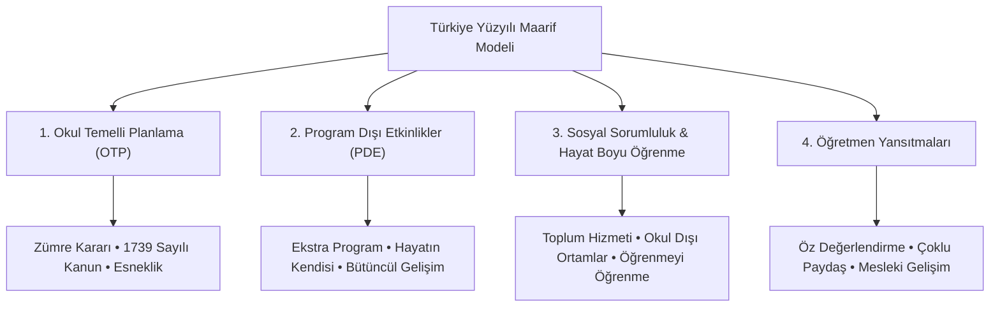

# 🎯 TÜRKİYE YÜZYILI MAARİF MODELİ (TYMM) — DERS 10 HAP ÖZETİ
## Okul Temelli Planlama, Program Dışı Etkinlikler, Sosyal Sorumluluk ve Öğretmen Yansıtmaları
> **EKYS 2027 Sınavına Hazırlık Başucu Çalışma Rehberi**  
> *Kaynak: MEB Türkiye Yüzyılı Maarif Modeli Ortak Metni & Canlı Ders Anlatım Çözümlemeleri*

---

## 📌 GİRİŞ: MAARİF MODELİNİN TAMAMLAYICI BOYUTLARI

Türkiye Yüzyılı Maarif Modeli; öğrenme çıktıları, içerik çerçevesi, öğrenme kanıtları ve öğrenme-öğretme yaşantılarından oluşan ana mimarisini **okulun yerel imkânları, öğrencinin bireysel potansiyeli ve okul dışı hayatla** bütünleştiren dört kritik tamamlayıcı unsurla nihai hedefine ulaşır:



---

## 1. OKUL TEMELLİ PLANLAMA (OTP)

### 🔹 Tanımı ve Amacı
* Millî Eğitim Bakanlığı tarafından hazırlanan çerçeve öğretim programlarında **esnek ve boş bırakılan alanların**, okulun imkânları, çevre koşulları ve öğrencilerin hazırbulunuşluk düzeyleri doğrultusunda öğretmen tarafından zenginleştirilmesini sağlayan planlı süreçtir.
* **Ana İlke: Öğretim Programlarının Esnekliği.** MEB öğretmene *"Programı harfiyen kopyala"* demez; *"Okulunun ve öğrencilerinin gereksinimlerine göre programı meşru çerçevede uyarla ve destekle"* der.

### 🔹 Karar Organı
* **Zümre Öğretmenler Kurulu** tarafından ders kapsamında gerçekleştirilmesi kararlaştırılır.
* Belli bir dersin yıllık planı içine entegre edilir.

### 🔹 4 Temel Dayanağı (ÖSYM’nin En Sevdiği Bilgi Sorusu)
Okul temelli planlama yapılırken öğretmenler ve zümreler şu dört unsuru mutlaka gözetmek zorundadır:
1. **1739 sayılı Millî Eğitim Temel Kanunu:** Türk Millî Eğitiminin Genel Amaçları ve 14 Temel İlkesi (Genellik, Eşitlik, Fırsat Eşitliği, Yönlendirme vb.).
2. **Öğretim Programlarının Genel Amaçları:** İlgili dersin ana felsefesi.
3. **Öğrenme Çıktıları:** Ulaşılmak istenen bilgi, beceri, eğilim ve değer bütünlüğü.
4. **Öğrenci ve Okul İhtiyaçları:** Okulun fiziki yeterliliği, bölgesel imkânlar ve öğrenci profili.

### 🔹 Uygulama ve Süreç Esasları
* **Yıllık Planlara İşlenir:** Spontane (anlık/plansız) yapılamaz. Tüm öğretim programlarının öğrenme alanları için ayrılan süre tablolarında okul temelli planlama haftaları/saatleri açıkça belirtilir.
* **Sistematik Döngü:**
  $$\text{İhtiyaç Belirleme} \longrightarrow \text{Faaliyet Yürütme} \longrightarrow \text{Etkiyi Değerlendirme}$$
* **Hangi Etkinlikleri Kapsar?**
  * Araştırma ve gözlem çalışmaları
  * Sosyal etkinlikler ve yerel saha çalışmaları
  * Okuma ve kütüphane etkinlikleri
  * Proje tabanlı ürün çalışmaları

> [!WARNING]
> **ÖSYM Çeldirici Tuzağı:**  
> • *"Okul temelli planlama öğretmen tarafından anlık ve plansız uygulanır"* $\rightarrow$ **YANLIŞ!** (Zümre kararıyla yıllık planlara işlenir).  
> • *"Öğretmen öğretim programı çıktılarından bağımsız tamamen serbest etkinlik yapar"* $\rightarrow$ **YANLIŞ!** (1739 sayılı kanuna ve öğrenme çıktılarına sıkı sıkıya bağlıdır, programın dışına çıkılamaz; tamamlayıcısıdır).

---

## 2. PROGRAM DIŞI ETKİNLİKLER (PDE / EKSTRA PROGRAM)

### 🔹 Pedagojik Mantığı (Posner & John Dewey Vurgusu)
* Posner'ın eğitim programı sınıflamasında yer alan **"Ekstra Program"** kavramının Maarif Modeli'ndeki somut karşılığıdır.
* Ders saatleri dışında, okulun gözetiminde planlı olarak yürütülen spor, sanat, bilim, kültür ve toplum hizmeti kulüplerini ifade eder.
* **Felsefi Temel (John Dewey):** *"Okul hayata hazırlık değil, hayatın ta kendisidir."* PDE, okul ile gerçek yaşam arasındaki yapay duvarları kaldırır.

### 🔹 PDE'nin Hizmet Ettiği 4 Temel Gelişim Boyutu

| Gelişim Boyutu | Kazandırılan Nitelikler |
| :--- | :--- |
| **Bireysel Gelişim** | Özgüven, bağımsız hareket edebilme, sorumluluk alma, zaman yönetimi. |
| **Sosyal-Duygusal Gelişim** | Empati kurma, takım çalışması, iş birliği, iletişim ve çatışma çözme. |
| **Entelektüel & Estetik Gelişim** | Sanatsal beğeni (zevk-i selim), eleştirel merak, kültürel miras bilinci. |
| **Karar Verme & Ahlaki Muhakeme** | Etik ikilemlerde doğru seçim yapma, toplumsal kurallara içtenlikle uyma. |

---

## 3. SOSYAL SORUMLULUK PROGRAMI VE HAYAT BOYU ÖĞRENME

### 🔹 Sosyal Sorumluluk Programı (SSP)
* **Temel Amaç:** Öğrencilerin bireysel dünyalarından çıkarak toplumsal sorunlara (çevre kirliliği, yaşlılık, sokak hayvanları, dezavantajlı gruplar, afet bilinci) duyarlı, çözüm üreten aktif yurttaşlar olmalarını sağlamaktır.
* **Disiplin Anlayışındaki Paradigma Değişimi:**  
  Cezalandırıcı disiplin anlayışı yerine, öğrenciyi topluma hizmet ettirerek rehabilite eden ve aidiyet hissi kazandıran yapıcı bir yaklaşım benimsenmiştir.
* **Uygulama Örnekleri:** Huzurevi ve çocuk esirgeme ziyaretleri, çevre ve fidan dikim projeleri, geri dönüşüm kampanyaları, kardeş okul dayanışması.

### 🔹 Hayat Boyu Öğrenme ve Okul Dışı Ortamlar
* Eğitim sadece dört duvar arasında (okul binasında) sınırlı kalamaz.
* **Okul Dışı Öğrenme Ortamları:** Müzeler, bilim merkezleri, sanat galerileri, sanayi tesisleri, kütüphaneler, tabiat parkları ve ören yerleri dersin doğal laboratuvarı kabul edilir.
* **Öğrenmeyi Öğrenme:** Öğrencinin okul bittikten sonra da kendi eksiklerini tespit edip bağımsız öğrenme stratejilerini sürdürebilme yetkinliğidir.

---

## 4. ÖĞRETMEN YANSITMALARI (YANSITICI ÖĞRETMENLİK)

### 🔹 Nedir ve Neden Önemlidir?
* Maarif Modeli sadece öğrencinin değil, **öğretmenin de sürekli gelişen bir öğrenen** olduğunu kabul eder.
* Öğretmenin ders bittikten sonra kendi öğretim sürecini, yöntem-tekniklerini ve kullandığı materyalleri eleştirel bir süzgeçten geçirmesidir (**Öz Değerlendirme / Mesleki Refleksiyon**).

### 🔹 Yansıtma Döngüsünün Kilit Soruları
1. *Planladığım öğrenme çıktılarına sınıfın ne kadarı ulaştı?*
2. *Hangi etkinlikte öğrenciler zorlandı veya koptu?*
3. *Kullandığım farklılaştırılmış öğretim (zenginleştirme / destekleme) yeterli oldu mu?*
4. *Bir sonraki derste neleri değiştirmeliyim?*

### 🔹 Çoklu Paydaş Katılımı
* Yansıtma sadece öğretmenin kendi iç sesinden ibaret değildir.
* **Geri Bildirim Kaynakları:**
  * Öğrenci gözlemleri ve ürün dosyaları
  * Zümre öğretmenleriyle yapılan paylaşımlar ve ders izleme notları
  * Veli geri bildirimleri

---

## 5. TYMM MİMARİSİ VE "SÜREÇ BİLEŞENİ" AYRIMI

Maarif Modeli'nde bir kavramsal veya alan becerisinin öğrenme çıktısına dönüşmesinde hiyerarşik bir yapı izlenir:

```
[Kavramsal / Alan Becerisi]
          ↓
[Süreç Bileşenleri] → (Beceriyi oluşturan işlem adımları / eylem basamakları)
          ↓
[Öğrenme Çıktısı]   → (Süreç bileşenlerinin konu ve değerle birleşmiş somut ifadesi)
```

> [!TIP]
> **ÖSYM Soru Şifresi:**  
> Soru kökünde *"bir beceriyi hayata geçirirken izlenen işlem basamakları, eylem adımları veya algoritmik sıra"* ifadesi geçiyorsa cevap doğrudan **Süreç Bileşeni**dir.

---

## 6. SINAV İÇİN 10 ALTIN HAP KURAL (ÖZET KODLAR)

1. **OTP Karar Merci:** Zümre Öğretmenler Kurulu.
2. **OTP Yasal Dayanağı:** 1739 Sayılı Millî Eğitim Temel Kanunu.
3. **OTP Zamanlaması:** Yıllık plana önceden işlenir, tablolarda ayrılan sürede uygulanır.
4. **OTP Esnekliği:** Programın dışına çıkmak değil; programı meşru çerçevede yerele uyarlamaktır.
5. **Program Dışı Etkinlik:** Posner'ın *Ekstra Programı*dır; akademik çalışmaları zenginleştirir.
6. **Felsefi İlke:** John Dewey'in *"Okul hayatın kendisidir"* (Hayatilik) ilkesi.
7. **Sosyal Sorumluluk:** Yaparak-yaşayarak değer kazandırma ve aktif yurttaşlık.
8. **Hayat Boyu Öğrenme:** Okul dışı öğrenme ortamları ve *öğrenmeyi öğrenme*.
9. **Öğretmen Yansıtması:** Öğretmenin kendi öğretimini çoklu paydaşlarla öz değerlendirmeye tabi tutmasıdır.
10. **Süreç Bileşeni:** Becerinin altındaki sıralı işlem/eylem basamaklarıdır.
